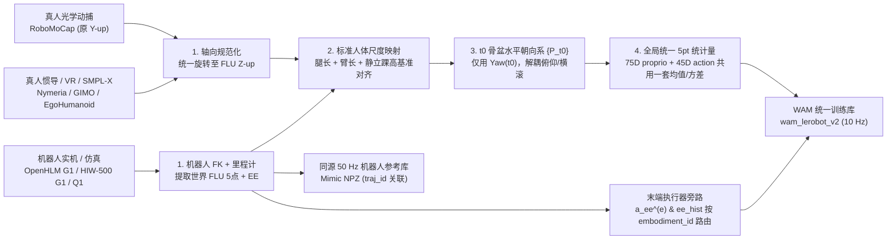

# WAM-Mimic 统一数据处理方案（Canonical Human 五点契约 v2.0）

> **本文档定位**：定义 WAM-Mimic 唯一正确的数据处理规范。先给出**总体处理逻辑**，再**逐一列出每个数据集的具体处理与修复方案**。所有旧文档中与本文档冲突的“双腕保留各构型原始米制”“各分支独立统计量混入同一 `embodiment_id`”“全 3D 骨盆系反投影”“Y-up 与 Z-up 混训”等规则一律作废。  
> **路径约束**：严禁在代码或配置中硬编码宿主机绝对路径；所有存储卷均通过环境变量 `${RAW_DATA_ROOT}`（只读）、`${PROCESSED_DATA_ROOT}`（读写）、`${PRETRAINED_ROOT}`（只读）、`${RUNS_ROOT}` 注入容器。  
> **关联文档**：[系统总架构设计](design.md) · [评估问题诊断与根因分析](evaluation-diagnosis.md) · [WAM–Mimic 协同与桥接规范](wam-mimic-bridge.md)

---

## 第一部分：总体处理逻辑

### 1.1 核心目标：一切数据源统一收敛至“标准人体五点空间”

无论原始数据来自**真人动捕**（光学、惯导、VR/SMPL-X）还是**真机/仿真机器人**（Unitree G1、PrimeBot Q1、Noetix Bumi），面向 WAM 的 ETL 管线都必须完成同一个目标：

> **将不同身高、不同臂展、不同坐标系、不同传感器来源的轨迹，全部重定向并规范化到唯一的“标准人体（Canonical Human）Z-up FLU 五点空间”**，使 WAM 永远只在稳定、构型无关的标准人体五点空间中学习“第一视角视觉 + 语言 → 未来全身运动趋势”；各机器人机身的动力学差异与执行器追踪由 Mimic 负责。

---

### 1.2 标准人体（Canonical Human / $H_5'$）五点空间数学规范（对齐 MorphMimic 与 Anchor 1）

本规范直接对齐 **MorphMimic**（[MorphMimic §III–§IV-A](https://lzyang2000.github.io/morphmimic/static/morphmimic.pdf) 及仓内 `morphmimic/model/human.py` Keypoint Goal v10）与 **Anchor 1**（[arXiv:2611.00193](https://arxiv.org/pdf/2611.00193) 的 $H_5'$ 结构保持五点几何标定与 Global + Ref. 契约）：
- **借鉴 Anchor 1 的 $H_5'$ 思想**：不做易引入滑步与奇异点的在线全关节 IK 重定向，而是通过**确定性骨架比例几何标定**（静立骨盆-踝垂距 $H_{\text{leg}}$、有效臂长 $L_{\text{arm}}$、零位轴偏置 $\mathbf{C}_{\text{rest}}$），将任意人类或机器人本体五点无损映射至标准人体五点 $H_5'$，保留肘/膝/腰的运动学冗余由底层 WBC 自主协调；
- **借鉴 MorphMimic 的 Heading Frame 与显式轴传输**：位置与朝向全部表达在 **锚点 $t_0$ 水平朝向系（Yaw-Only Heading Frame）** 中（`human.py` 明确指出：v3 曾相对带横滚/俯仰的 3D 骨盆表达目标，导致轻微机身倾斜就使全部目标反向倾倒），并通过可逆常量矩阵 $\mathbf{C} = \mathbf{R}_z(\text{HUMAN\_YAW\_OFFSET})\mathbf{R}_x(\text{HUMAN\_ROLL\_OFFSET})$ 在 FLU 与 SMPL 局部轴间做显式无损传输（与 `prepare_mimic_robot_five.py` 一致）。

所有进入 WAM 训练与推理的五点张量必须严格满足以下 **5 项硬约定**：

1. **统一右手坐标系（ROS REP-103 FLU）**：
   - $+X$ 朝前（前进方向）、$+Y$ 朝左、$+Z$ 竖直向上（逆重力方向）。
   - 五点固定顺序：`[0: Pelvis, 1: LeftAnkle, 2: RightAnkle, 3: LeftWrist, 4: RightWrist]`。
   - **禁止任何 Y-up 或局部骨骼自定轴直接入库**：所有点的位置与局部 3×3 旋转矩阵在进入特征提取前，必须左/右乘固定标定矩阵对齐到“标准直立面朝 $+X$ 时五点旋转矩阵均接近单位阵 $\mathbf{I}_3$”的 FLU 约定。
2. **统一参考系：观测时刻 $t_0$ 的水平朝向骨盆系 $\{P_{t_0}\}$（Yaw-Only Heading Frame）**：
   - 原点为 $t_0$ 时刻的骨盆世界位置 $\mathbf{p}_{0}(t_0)$；
   - 朝向仅取 $t_0$ 骨盆的偏航角 $\mathbf{H}_0 = \mathbf{R}_z(\psi_{t_0})$，**不包含 $t_0$ 的俯仰（pitch）与横滚（roll）**。
   - 为什么必须用 Yaw-Only 而非完整 3D 骨盆系？
     - 在 $\{P_{t_0}\}$ 中，重力方向永远严格沿 $-Z$，双踝高度 $z$ 始终代表真实离地/相对站高，**不会因躯干前倾鞠躬而把脚踝坐标甩到身后半空**；
     - 骨盆真实的 pitch/roll 俯仰动作依然完整保留在 `pelvis_rot6d`（$\mathbf{H}_0^\top \mathbf{R}_{\text{pelvis}}(t)$）中，弯腰、下蹲、起身零信息损失。
3. **统一标准人体几何尺度（Canonical Human Skeleton）**：
   - 定义唯一标准人体参考尺寸（对应标准成人骨架）：
     - 标准骨盆-踝垂直站高：$H_{\text{leg}}^{\text{canon}} = 0.85\text{ m}$（标准站立时 $z_{\text{ank}}^{\text{canon}} = -0.85\text{ m}$，若以 $L_{\text{leg}}^{\text{canon}} = 0.85\text{ m}$ 表达则无量纲站立踝高恒为 **$-1.00$**）；
     - 标准双肩/双臂工作半径标尺：$L_{\text{arm}}^{\text{canon}} = 0.58\text{ m}$（肩-腕有效臂长，对应成人双腕自然前伸与肩宽比例）。
   - 对任意源主体 $s$（无论是身高 `1.65 m` / `1.82 m` 的人类，还是 `1.32 m` 的 G1、`0.88 m` 的 Q1），先标定该主体的实测静立几何参数：
     - 实测站立骨盆-踝垂直距离 $H_{\text{leg}}^{(s)} = z_{\text{pelvis}}^{\text{stand},(s)} - \frac{1}{2}(z_{\text{LA}}^{\text{stand},(s)} + z_{\text{RA}}^{\text{stand},(s)})$；
     - 实测臂长标尺 $L_{\text{arm}}^{(s)}$（由骨架肩-肘-腕连杆和或机器人 URDF 精确计算：Q1 `0.36 m`、Bumi `0.39 m`、G1 `0.50 m`、人类由实测骨架上臂+前臂求得）。
   - **源主体 → 标准人体五点重定向公式**（在世界 FLU 系完成，再投影至 $\{P_{t_0}\}$）：
     - **下肢（骨盆、左踝、右踝，$i \in \{0,1,2\}$）**：
       $$\tilde{\mathbf{p}}_i(t) = \mathbf{H}_0^\top \big(\mathbf{p}_i^{(s)}(t) - \mathbf{p}_0^{(s)}(t_0)\big) \cdot \frac{1}{H_{\text{leg}}^{(s)}}$$
       由于分母使用**该主体的真实站立骨盆-踝垂距 $H_{\text{leg}}^{(s)}$**（而不是写死且与实际站高不符的名义腿长常量），所有来源在直立站姿下都严格满足：$\tilde{z}_{\text{LA}} \approx \tilde{z}_{\text{RA}} \approx -1.00$、$\tilde{y}_{\text{LA}} > 0$、$\tilde{y}_{\text{RA}} < 0$，彻底消除 G1（`-1.095`）与 Q1（`-0.861`）之间的 25% 基准断层。
     - **双腕（左腕、右腕，$i \in \{3,4\}$）**：
       先将双腕拆分为“随骨盆平移项 + 相对骨盆臂展项”，分别按腿长比与臂长比映射到**标准人体米制工作空间**：
       $$\tilde{\mathbf{p}}_i(t) = \mathbf{H}_0^\top \big(\mathbf{p}_0^{(s)}(t) - \mathbf{p}_0^{(s)}(t_0)\big) \cdot \frac{H_{\text{leg}}^{\text{canon}}}{H_{\text{leg}}^{(s)}} + \mathbf{H}_0^\top \big(\mathbf{p}_i^{(s)}(t) - \mathbf{p}_0^{(s)}(t)\big) \cdot \frac{L_{\text{arm}}^{\text{canon}}}{L_{\text{arm}}^{(s)}}$$
       这样 Q1、G1、真人的双腕全部落在同一个标准人体米制工作空间中；同时保留机器人原生末端指令 $\mathbf{a}_{\text{ee}}^{(e)}$ 在旁路通道。
     - **五点旋转（$i \in \{0..4\}$）**：先用该源标定好的局部零位偏置矩阵 $\mathbf{C}_{\text{rest}, i}^{(s)}$ 归零到直立 FLU 朝向，再计算相对 $\mathbf{H}_0$ 的 `rot6d`（前两列）：
       $$\tilde{\mathbf{R}}_i(t) = \mathbf{H}_0^\top \big(\mathbf{R}_i^{(s)}(t)\,\mathbf{C}_{\text{rest}, i}^{(s)}\big)$$
4. **严格因果 4 帧本体历史与 10 帧动作块**：
   - `observation.state_5pt_hist`：`[4, 75]`（$t_0 - 0.3\text{s} \dots t_0$），每帧为 `45D 标准人体五点位姿 + 15D 线速度 + 15D 角速度`，全部在同一个 $\{P_{t_0}\}$ 系下表达；线/角速度仅用 $t \le t_0$ 的实测前驱帧后向差分，严禁未来帧平滑泄漏。
   - `observation.ee_hist`：`[4, 4]`（`[ee_meas(2), ee_res(2)]`，无末端监督的真人数据置零并由 `ee_mask = 0` 屏蔽）。
   - `action`：`[10, 45 + D_ee]`（$t_0 + 0.1\text{s} \dots t_0 + 1.0\text{s}$ @ 10 Hz），前 `45D` 恒为标准人体五点目标，后 `D_ee` 仅在携带真实末端标签的构型上计算损失。
5. **全局统一归一化与 `embodiment_id` 解耦**：
   - **所有数据分支的 `75D` 五点历史与 `45D` 五点动作，强制共享同一份全局训练统计量 `canonical_human_5pt_stats.json`**（仅在所有活跃分支的 `train` split 上按采样权重拟合）。严禁再出现“同一 `embodiment_id` 下各分支各自 Z-score 归一化”的语义冲突。
   - **`embodiment_id` 只用于路由末端执行器编解码头与条件嵌入**（`0 = bimanual_stub`、`1 = bimanual_parallel_gripper`、`2 = human_5pt_only`、`3+ = dex hands`），不再承担区分不同五点坐标系或不同身高的职责。

---

### 1.3 视觉视频与文本潜码统一预处理规范

1. **单目防误裁硬规则（针对双目/宽幅视频）**：
   - 在任何转码开始前，ETL 必须先探测源视频分辨率 $(W, H)$ 与宽高比 $W/H$：
     - 若 $W/H > 2.2$（如 `1280×480`、`2560×720` 等左右拼接双目流），**严禁直接居中裁剪**，必须显式切出**左目单路**（`x ∈ [0, W/2)`）后再做方形中心裁剪与缩放至 `224×224 @ 10 Hz`。
     - 若为竖置或旋转的头戴流（如 Project Aria），必须先完成旋转校正再缩放，并在 QA 联系表中核对天空/天花板朝上。
2. **广角/鱼眼与针孔视野兼容**：
   - 保留原生 `224×224 @ 10 Hz` 离线视频缓存（主视口），同时对极端 180° 圆形鱼眼源（如 OpenHLM）**额外导出或支持去黑边内切中心裁剪视图（如中心 `70%` 方形裁切模拟 ~90° 广角针孔）**，缩小真实鱼眼与仿真/实机针孔相机之间的几何域差。
3. **Cosmos-Predict2.5 因果潜码缓存（保持固定版本）**：
   - 视频潜码：`[16, 5, 28, 28]` BF16（固定前缀 5 帧 `[t-3, t-3, t-2, t-1, t]` + 12 帧未来，共 17 帧，仅前 2 个时间潜码作为 WAM 动作条件；校验替换未来像素不改变前 2 潜码）。
   - 文本潜码：`prompt_bank_bf16.safetensors`（固定修订 Cosmos-Reason1-7B 28 层逐 token 归一化拼接 `[512, 100352]` BF16）。
   - **仅当 MP4 视频与文本发生变更时才重算潜码**（如 `hiw500` 修复双目裁剪后必须重跑视频潜码；仅重算五点坐标/统计量的分支可直接复用既有视频与文本潜码！）。

---

### 1.4 运动多样性分桶与采样均衡（根治“原地定脚不动”偏置）

每个训练窗口在 ETL 阶段自动计算并写入 3 个运动学元标签到 Parquet / `episodes.jsonl`：
- `pelvis_disp_1s`：未来 1.0 s 骨盆水平位移 $\|\Delta \mathbf{p}_{0, xy}(t_0+1\text{s})\|_2$（标准人体米制）；
- `ankle_max_lift_1s`：未来 1.0 s 双踝最大抬脚高度 $\max(\Delta z_{\text{LA}}, \Delta z_{\text{RA}})$；
- `wrist_disp_1s`：未来 1.0 s 双腕相对骨盆最大位移。

按运动类型将全部训练窗口划分为三类桶并在 `DataLoader` 中强制目标配比：

| 运动桶 | 判定阈值（标准人体尺度） | 目标训练采样占比 | 目的 |
| :--- | :--- | :---: | :--- |
| **Bucket A · 行走与移动接近（Locomotion / Loco-Manip）** | `pelvis_disp_1s >= 0.15 m` 或 `ankle_max_lift_1s >= 0.06 m` | **50% ~ 55%** | 强化迈步抬脚、走近桌台、绕障与步态-手臂协同 |
| **Bucket B · 近场双臂主动操作（Active Manipulation）** | 非 Bucket A 且 `wrist_disp_1s >= 0.12 m` | **35% ~ 40%** | 强化到桌前后的伸手对准、按压、抓放、开关操作 |
| **Bucket C · 静立/低速驻留（Idle / Fine Hold）** | 其余低速静止窗口 | **≤ 10%** | 保留平稳驻立与微调能力，防止刷屏淹没迈步梯度 |

---

### 1.5 入训前六项硬性 QA 门禁（缺一不可）

任何数据集在并入 WAM 训练前，必须通过自动化校验并产出 `qa_reports/<branch>_canonical_ready.json`：

1. **坐标轴与符号门禁（自动拦截 Y-up / 左右镜像）**：
   - 全量 `train` 窗口中位数必须满足：`L_ank_z ∈ [-1.10, -0.85]`、`R_ank_z ∈ [-1.10, -0.85]`、`L_ank_y > +0.05`、`R_ank_y < -0.05`、`L_wri_y > 0`、`R_wri_y < 0`、`wri_x_median > 0`。不满足直接报错中止，彻底杜绝 Y-up 混入 Z-up。
2. **坐标往返精度门禁**：
   - 抽样执行 `Canonical Human -> Target Robot (Q1 & G1) -> Canonical Human` 往返测试，位置误差 `< 1 mm`、旋转误差 `< 0.1°`、`rot6d` 正交残差 `< 1e-4`、零 `NaN/Inf`。
3. **视频画面目视与自动拼缝检测门禁（自动拦截双目错裁）**：
   - 自动检测 `224×224` 帧中央列（`x = 111..112`）垂直梯度跳变异常（拦截双目跨缝裁剪）；
   - 每个分支必出 20 条随机窗口联系表（`qa_previews/<branch>_rgb_contact.png`）+ Rerun 3D 五点坐标簇叠加图，人工确认无黑屏、无倒置、无拼缝、无左右手翻转。
4. **因果性门禁**：
   - 校验历史 4 帧时间戳严格 $\le t_0$；校验替换后 12 帧 RGB 像素后前 2 个 VAE 条件潜码差值严格为 `0`。
5. **划分隔离门禁**：
   - 按完整受试者 / 录制会话 / 独立场景隔离 `train / val / test`；`human-operations` 固定独立只读回归集，严禁混入训练。
6. **全局统计量一致性门禁**：
   - 核验新分支数据经**全局 `canonical_human_5pt_stats.json`** 归一化后，静立态五点均值落在 `[-1.5σ, +1.5σ]` 合理区间内（不再出现 `+7.3σ` 异常）。

---

## 第二部分：逐数据集详细处理规范

下表先给出全部现有与规划数据源的总览，随后逐项说明**每个数据集具体要做什么处理**。

| 数据集 | 类型与状态 | 复用既有视频/文本潜码？ | 当前核心缺陷 | 处理优先级 |
| :--- | :--- | :---: | :--- | :---: |
| **1. HIW-500 G1 (`hiw500`)** | 实机 G1（1,280 回合 / 55.6 万窗） | **❌ 必须重跑视频与潜码** | 双目 `480×1280` 跨缝居中裁剪 Bug；未转标准人体五点；原地静止窗占比极高 | **P0（最紧急）** |
| **2. RoboMoCap (`human-base` + `human-new` + `human-operations`)** | 真人光学（175+12 会话 / 19.8 万窗） | **✅ 可直接复用** | 坐标停留在 **Y-up / Z-forward**；双腕未做臂长标准化；`human-new` 大量定脚原地任务 | **P0（最紧急）** |
| **3. OpenHLM G1 (`gripper`)** | 实机 G1（406 回合 / 13.2 万窗） | **✅ 基础可复用（建议增补去黑边中心裁切视图）** | 存的是 G1 FK 而非标准人体五点（踝高 `-1.095`、G1 臂长）；180° 极端鱼眼与针孔域差大 | **P0（最紧急）** |
| **4. Nymeria (`nymeria` + `nymeria-40` + 后续扩容)** | 真人惯导（3+32 条 / 29 万窗） | **✅ 既有 32 条可复用** | 旧 3 条以坐姿写白板为主；与 `human-protocol` 统计量/坐标冲突；需补齐绕障+操作流式扩容 | **P0（对齐）/ P1（扩容）** |
| **5. Mimic 50 Hz 参考库与 Stage 3 回灌** | Q1 / Bumi / G1 全身参考 | — | 原评测仍用 12k H1 权重；未做 WAM 预测 `465D` 回灌联训 | **P1（闭环协同）** |
| **6. 未来扩展集（GIMO / EgoHumanoid V2 / HumanVerse-500 / 高质量 Sim）** | 真人 Ego / 可选高质量仿真 | 新接入按 v2.0 一步到位 | 尚未全量接入；低质 `sim` 保持停训 | **P1 ~ P2** |

---

### 数据集 1：HIW-500 G1（`hiw500` · `BitRobot/HIW-500-LeRobot`）

- **原始形态**：1,280 条真实开放世界 G1 移动操作回合（11 类任务），30 Hz 关节角 `observation.state`（29-DoF）+ `observation.state.wbc`（骨盆姿态/速度/高度 + 夹爪触发）+ 30 Hz `480×1280` 左右双目拼接头相机 MP4。
- **需要做的具体处理**：
  1. **【P0 必改】修复双目视频裁剪并重编码视频与 VAE 潜码**：
     - 修改 `wammimic/data_pipeline/hiw500.py` 中的 `_transcode_segment()`：把错误的 `crop=ih:ih:(iw-ih)/2:0` 改为**只取左目中心方形** `crop=480:480:80:0,scale=224:224:flags=lanczos`（即在 `640×480` 左目内部水平居中裁剪 `480×480`，彻底避开 `x=640` 双目拼缝）。
     - 重新转码全部 1,280 条 MP4，跑自动化中缝梯度检测 + 抽检 20 条视觉联系表，确认无拼缝后重跑 4 卡 Cosmos VAE 视频潜码缓存（文本潜码 `prompt_bank_bf16.safetensors` 可直接复用，无需重跑）。
  2. **【P0 必改】G1 FK → 标准人体（Canonical Human）Z-up FLU 五点重定向**：
     - 在 `_fk_sequence()` 导出世界 FLU 50 Hz / 10 Hz 五点后，标定 G1 在 HIW-500 中的实测站立骨盆-踝垂距 $H_{\text{leg}}^{\text{g1}}$ 与臂长 $L_{\text{arm}}^{\text{g1}} = 0.50\text{ m}$，按第一部分 §1.2 公式转换为 **Yaw-Only 骨盆系 $\{P_{t_0}\}$ 下的标准人体五点**（使静立踝高严格归一化至 `-1.00`，双腕映射至标准人体米制工作空间）。
     - 保留 `ee_cmd`（`[10, 2]`）与 `ee_obs4`（`[4, 4]`）原样不变，`embodiment_id = 1`。
  3. **【P0 必改】运动分桶标注与静止降采样**：
     - 逐窗写入 `pelvis_disp_1s`、`ankle_max_lift_1s`、`wrist_disp_1s`；将大量原地不动窗口归入 Bucket C（训练时限制占比 ≤10%），重点提升 `setting the table`、`picking trash to rubbish bin`、`restocking fridge` 等含走动与伸手交互的活跃段权重。
  4. **【P0 必改】移除独立 5pt 归一化，接入全局统计量**：
     - 保留 `hiw500` 自身 `splits.json` 隔离不变，五点部分改用全局 `canonical_human_5pt_stats.json` 归一化。

---

### 数据集 2：RoboMoCap 真人光学动捕（`human-base`、`human-new`、留出回归集 `human-operations`）

- **原始形态**：`human-base`（23 会话）+ `human-new`（152 会话）合计 175 会话 / 186,003 窗口，另含独立只读回归集 `human-operations`（12 会话 / 12,185 窗口）；30 Hz 头戴单目 RGB + 120 Hz NOKOV 光学解算骨架。
- **需要做的具体处理**：
  1. **【P0 必改】坐标系从 Y-up / Z-forward 旋转对齐至标准 FLU（Z-up / X-forward / Y-left）**：
     - 读取 `human_ego/labels/episode_*.npz` 中保留的原始 120 Hz 世界坐标五点与四元数，对每个会话用静立帧标定标准正交旋转矩阵 $\mathbf{R}_{\text{nokov}\to\text{FLU}}$（把 NOKOV 的 $+Y_{\text{up}} \to +Z_{\text{up}}$、$+Z_{\text{fwd}} \to +X_{\text{fwd}}$、$+X_{\text{left}} \to +Y_{\text{left}}$）及五点局部零位偏置 $\mathbf{C}_{\text{rest}, i}$，确保转换后静立态严格满足 `L_ank_z ≈ -1.00`、`L_ank_y > 0`、`R_ank_y < 0`、`wri_x > 0`。
     - 用转换后的世界 FLU 轨迹，按第一部分 §1.2 重导出 **Yaw-Only 骨盆系 $\{P_{t_0}\}$** 下的 `action [10, 45]` 与 `observation.state [4, 75]`。
  2. **【P0 必改】受试者腿长与臂长双标尺标准化**：
     - 除已有的 `human_leg_length` 外，从同源 BVH/NPZ 骨架或静立 T/A-pose 计算该受试者真实站立骨盆-踝垂距 $H_{\text{leg}}^{(s)}$ 与臂长 $L_{\text{arm}}^{(s)}$，将双腕相对骨盆位移统一缩放至标准人体臂长 $L_{\text{arm}}^{\text{canon}} = 0.58\text{ m}$。
  3. **【P0 必改】区分“行走/移动操作”与“定脚操作（Do not step）”并打运动桶标签**：
     - 统计发现 `human-new` 中大量任务要求双脚不得离开标记点。通过 `pelvis_disp_1s` 与 `ankle_max_lift_1s` 自动打桶标签：保留其中有价值的近场双臂桌面操作进入 Bucket B，避免其大量静态双踝样本稀释 Bucket A 的迈步分布。
  4. **潜码与划分复用**：
     - 既有 224×224 视频、`latents/*.safetensors` 与 `prompt_bank_bf16.safetensors` **100% 复用，无需重算**。
     - `human-operations`（12 会话）同步应用相同的 Y-up → FLU 转换以供离线评估，但**严格保持只读留出，永不进入训练**。

---

### 数据集 3：OpenHLM G1 实机遥操（`gripper` · `g1_parallel_gripper`）

- **原始形态**：406 条真实 G1 移动操作遥操回合（12 类典型“走近桌台/货架/垃圾桶/抽屉 → 操作 → 转身走回”任务），131,944 窗口；30 Hz OpenPI 关节角 + 180° 圆形鱼眼头相机。这是当前**高质量移动操作（行走+伸手）占比最高的机器人分支**。
- **需要做的具体处理**：
  1. **【P0 必改】从 G1 FK 重定向为标准人体（Canonical Human）Yaw-Only 五点**：
     - 直接读取已有 `morph_5pt_store/g1/openhlm_*/poses.npy`（50 Hz 世界 FLU 五点，无需重跑原始 Parquet 下载与 FK），标定 G1 在 OpenHLM 中的实测静立骨盆-踝垂距 $H_{\text{leg}}^{\text{g1}} \approx 0.745\text{ m}$ 与臂长 $L_{\text{arm}}^{\text{g1}} = 0.50\text{ m}$。
     - 按第一部分 §1.2 公式重新生成 `action [10, 47]`（前 45D 为标准人体五点，后 2D 保留夹爪目标 `[0, 1]^2`）与 `observation.state_5pt_hist [4, 79]`（前 75D 为标准人体历史，后 4D 保留夹爪实测/残差）。
     - 改完后 OpenHLM 的静立踝高从 `-1.095` 对齐至 `-1.00`，双腕臂展对齐至标准人体尺度，彻底与真人分支无缝融合。
  2. **【P1 强烈建议】鱼眼画面去黑边裁剪增广（缓解鱼眼→针孔域差）**：
     - 当前 OpenHLM 画面四周有大面积黑色鱼眼遮罩，与 Genie Sim / 针孔相机差异大。
     - 保留原版 `cam_head` 潜码的同时，新增一路**中心内切裁剪版**（从原始 180° 鱼眼画面裁出中心有效圆形内接正方形，再缩至 `224×224` 编码潜码），训练时随机在“原鱼眼视图”与“去黑边广角视图”之间采样（同源动作标签完全不变），显著提升向针孔相机与仿真的视觉泛化。
  3. **采样地位提升**：
     - 由于 OpenHLM 天然富含“走近 → 抬臂对准 → 抓放”连续片段，绝大多数窗口落入 Bucket A / B，应作为 `embodiment_id = 1` 的核心高质量示范源保持稳定采样比重。

---

### 数据集 4：Nymeria 真人惯导第一视角（`nymeria` + `nymeria-40` + 后续扩容）

- **原始形态**：`nymeria`（旧 3 条，2.3 万窗，主要为沙发坐姿写白板）+ `nymeria-40`（32 条，29.2 万窗，26/3/3 受试者隔离，覆盖多房间行走、开柜门、拿放物品）；Project Aria 头戴 RGB + 240 Hz Xsens 惯导全身真值 + 分层自然语言叙述。
- **需要做的具体处理**：
  1. **【P0 必改】隔离/降权旧 `nymeria` 坐姿 3 条，主用 `nymeria-40`**：
     - 旧 `nymeria` 3 条的踝高均值仅 `-0.454`（长时间坐姿），不应与站立行走数据混算统计量；将其标为低权坐姿子集（仅按 Bucket C 限额采样或移出默认训练列表），以 `nymeria-40`（32 名独立受试者）作为主力。
  2. **【P0 必改】重导出 Yaw-Only 骨盆系 + 双标尺（腿长+臂长）标准人体五点**：
     - `nymeria-40` 本身已是 Z-up / X-forward（`L_ank z ≈ -0.864`），直接从已有 `labels/` 世界坐标五点重算，按每名受试者的实测站立骨盆-踝垂距 $H_{\text{leg}}^{(s)}$ 与臂长 $L_{\text{arm}}^{(s)}$ 规范化至标准人体五点（静立 `z ≈ -1.00`），并改为 Yaw-Only `{P_{t0}}` 参考系。
     - **既有视频与文本潜码 100% 复用，无需重新下载 VRS 或重跑 VAE**。
  3. **【P1 持续扩容】定向筛选“绕障行走 + 桌台/开关/门交互”流式扩量**：
     - 保持“先筛官方语言元数据关键词（`walk around / avoid / table / counter / switch / button / press / cabinet / reach`）→ 单条下载 VRS → 解码导出标准人体五点 + 潜码缓存 → 通过六项 QA 门禁 → 立即删除原始 VRS”的流式管线，将高质量室内移动操作扩充至 `60~100` 条独立受试者序列。

---

### 数据集 5：Mimic 50 Hz 参考库与 Stage 3 WAM 预测回灌

- **原始形态**：`runs/mimic-official-recovery-training-20261122/data`（包含 `q1 / bumi / g1` 三机身 50 Hz 原生 NPZ、`human50` 原始人体五点 sidecar、`robot_reference50` 机器人五点参考及 Q1 官方起身动作），已训练出 40,000 步 H=10 权重（`mimic-all-motion-resume12000-40000-20261122`）。
- **需要做的具体处理**：
  1. **【P0 立即切换】全面淘汰 12,000 步 H=1 权重，统一使用 40,000 步 H=10 权重**：
     - 所有闭环评估、可视化与后续回灌均以 `mimic-all-motion-resume12000-40000-20261122/{q1,bumi,g1}/ckpt_40000.pt` 为基线。
  2. **【P1 闭环对齐】验证 `human50` 与 WAM 标准人体五点空间的尺度/轴向一致性**：
     - 核对 WAM 输出的 Canonical Human 五点（Z-up FLU，标准站高 `0.85 m`，臂长 `0.58 m`）送入 Mimic 共享 Human Encoder（`goal_kp`）前的局部轴转换矩阵（SMPL / FLU 固定偏移），确保零误差对齐。
  3. **【P1 Stage 3 回灌】构建 WAM 预测 `465D` 回灌配对库**：
     - 待新版统一 Canonical Human 空间 WAM 训练通过离线门禁后，对共享轨迹执行 WAM 推理，将**含真实预测噪声与 5 Hz 块边界跳变**的五点预测（经 Yaw 桥接重定向为目标机型参考）配对真值机器人全身轨迹，与干净数据按 `50:50` 混合并开启 `kp_jitter / kp_drift`，对 Mimic 40k 进行 Stage 3 鲁棒性续训。

---

### 数据集 6：后续扩展数据源（GIMO / EgoHumanoid V2 / HumanVerse-500 / 仿真 Sim）

所有新数据源**必须一步到位按本规范 v2.0 接入**，不再产生历史债务：

| 数据源 | 定位与优先级 | 接入处理要点 |
| :--- | :---: | :--- |
| **GIMO**（Stanford） | **P1（多障碍室内导航+交互）** | 从 SMPL-X 提取世界 FLU 5 点 → 标定受试者 $H_{\text{leg}}^{(s)}, L_{\text{arm}}^{(s)}$ → 导出 Yaw-Only 标准人体 `4×75` + `10×45` → 过六项 QA 门禁（`emb_id = 2`） |
| **EgoHumanoid / V2**（OpenDriveLab） | **P1（同协议定向实采利器）** | 复用开源穿戴式采集/对齐管线，直接针对“绕障 → 走近桌面 → 按按钮/抓物体”实采 50–100 条真人演示，按 v2.0 导出后作为高价值微调包 |
| **HumanVerse-500**（$\lambda_0$ / OpenLambda） | **P2（大规模开放世界预训练）** | 接入开源切片后走与 Nymeria 相同的流式解码-标准人体转换-潜码缓存-QA 门禁管线 |
| **Genie Sim 仿真数据（`sim`）** | **当前暂停入训（仅作评测台）** | 在动作自然度与手物同框门禁达标前保持权重 `0.0`；若未来重启少量 Sim 数据弥补仿真针孔视觉域差，**同样必须反向重定向到标准人体五点空间**并经受六项门禁校验 |

---

## 第三部分：立即可执行的重处理顺序（最小返工路径）

1. **Step 1（代码改造）**：在 `wammimic/data_pipeline/` 中落地统一的 `canonical_human.py`（实现 `world_flu_to_canonical_5pt()`、Yaw-Only `{P_{t0}}`、腿长+臂长双标尺重定向、运动分桶指标计算与六项 QA 自动检查脚本）。
2. **Step 2（零视频重算的 3 个分支秒级刷新）**：用已有世界坐标标签直接重导出 `human-base` / `human-new` / `human-operations`（修 Y-up → FLU）、`gripper`（G1 → 标准人体）、`nymeria-40`（统一 Yaw-Only + 臂长），复用全部现有视频与文本潜码。
3. **Step 3（`hiw500` 双目裁剪修复）**：修改 `hiw500.py` 为左目中心裁剪，重转 1,280 条 MP4、重跑 4 卡 Cosmos VAE 潜码并同步导出标准人体五点 Parquet。
4. **Step 4（拟合唯一全局统计量 & 启动重训）**：合并全部活跃分支的 `train` 窗口拟合唯一 `canonical_human_5pt_stats.json`，通过六项 QA 门禁与目视抽检后，按运动桶配比（Bucket A 50%+ / B 40% / C ≤10%）启动新版 WAM 训练（2–3 epoch）。
