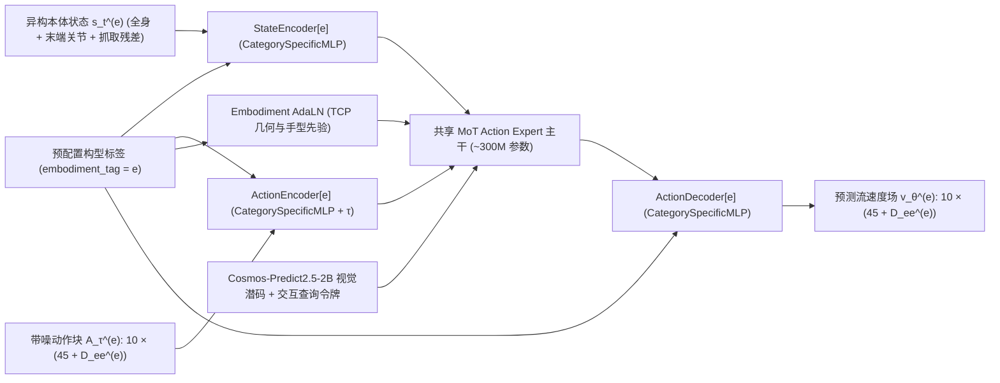
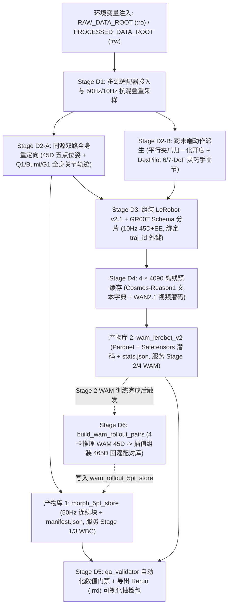
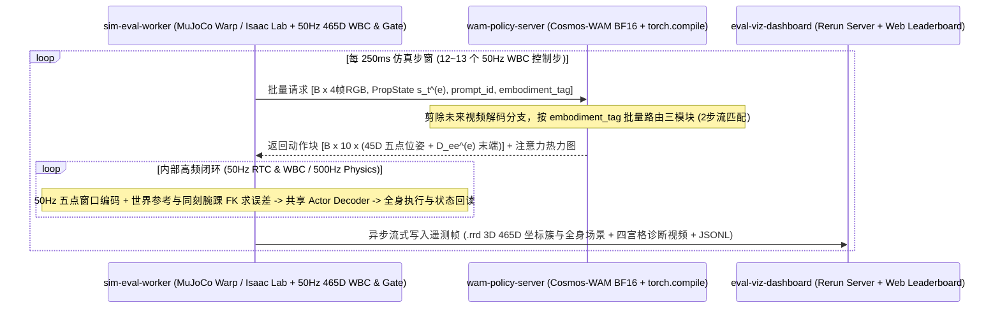
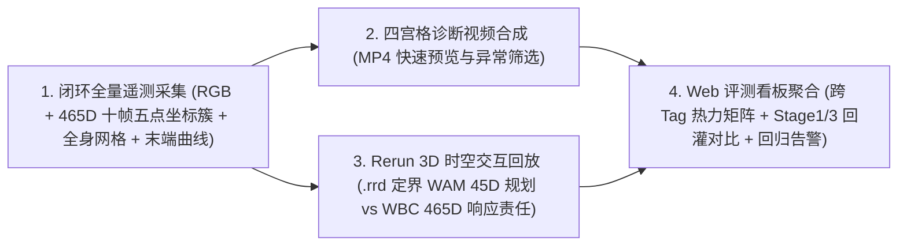

# WAM-Mimic 跨构型人形机器人全身移动操作算法与训练评估设计文档

> **文档版本**：v1.9（2026-11-21，明确原始人体与机器人参考两种五点，接入 MotionDecode 训练样本）  
> **基准训练与评估算力**：单机 4 × NVIDIA RTX 4090（单卡 24GB 显存，PCIe 4.0 互联，无 NVLink）  
> **工程实施顺序**：Phase 0 数据准备 $\to$ Stage 1~4 联合训练与回灌 $\to$ 单机型合并验收 $\to$ Genie Sim 操作评测及跨构型闭环回归（[§8.4](#84-genie-sim-接入与最终合并验收)）  
> **目标仿真机身构型**：启元 PrimeBot Q1、松延动力 Noetix Bumi、宇树 Unitree G1  
> **支持末端执行器构型**：球头盲端（Stub）、双手平行夹爪（Parallel Gripper）、多规格双灵巧手（6-DoF / 7-DoF 及可扩展高自由度灵巧手）  
> **观测输入模态**：第一视角单目 RGB 图像流 + 本体感知状态（全身关节状态 + 虚拟骨盆 IMU + 末端执行器关节状态与跟踪残差）  
> **核心算法栈**：`Cosmos-Predict2.5-2B` + `GR00T N2-Style MoT Action Expert`（共享动作主干 + `EmbodimentTag` 路由编解码，单步输出 `45D 五点位姿 + 末端动作`） + `Global-MorphMimic`（`465D` 五点编码、共享 Actor Decoder 和必需的 Global + Ref. 腕踝位姿反馈，输出全身电机动作）

---

## 1. 项目定位与设计目标

**WAM-Mimic** 旨在构建一套同时支持**跨身高机身**与**异构末端执行器（盲端球头 / 双手夹爪 / 双灵巧手）**的人形机器人“视觉理解—避障导航—全身灵巧操作”学习与仿真闭环评测系统。围绕“高层稀疏五点运动规划 + 底层全自由度电机控制生成”的分层思想，本设计确立以下五项核心准则：

1. **45D 稀疏五点位姿规划与 465D 全身电机控制解耦**：人类在移动操作时规划的是躯干核心与四肢末端的空间位姿趋势，而非逐个计算全身二十余个电机的转角。据此，`Cosmos-WAM` 单帧输出 **5 个关键点（骨盆、左踝、右踝、左腕、右腕）的 `15D 三维位置 + 30D 连续 6D 旋转 = 45D` 位姿**及**末端执行器指令**；经上采样切片为 **连续 10 帧窗口（`450D`）并拼接 `15D 掩码`（5 位点掩码 + 10 位帧可见掩码）组成完整的 `465D` 五点指令张量**送入 `Global-MorphMimic`（WBC），由 WBC 负责输出协调自然的全身各关节精确电机目标。
2. **参考 GR00T N2 的“共享动作主干 + 构型标签（Embodiment Tag）路由”范式**：在 WAM 动作专家层保留统一的跨构型时空推理主干，通过预先配置的 `embodiment_tag` 同步路由轻量级构型专属状态编码器（State Encoder）、动作编码器（Action Encoder）与动作解码器（Action Decoder），在同一套基础模型下兼容球头盲端、双手平行夹爪及不同自由度的双灵巧手。
3. **同源双路重定向与 WAM 预测回灌混合训练机制**：在数据工程上，将同一运动轨迹**同时重定向为 45D 五点位姿序列与各目标机器人的全身关节轨迹**，使 WAM 与 Mimic 共用同源动作数据；训练出 WAM 后，进一步将 **WAM 推理输出的 45D 五点预测序列组装为 465D 窗口，配对对应的真值机器人全身轨迹**并入 Mimic 训练集联合优化，消除规划分布与底层控制输入分布之间的失配。
4. **纯单目 RGB 驱动与混合标尺跨机身复用**。依靠单目运动视差与滑动支撑腿运动学里程计估计机器人在回合世界系中的根位姿。45D 五点采用“下肢腿长归一化 + 双腕真实米制”混合标尺兼容 $0.88\text{ m}$ 至 $1.32\text{ m}$ 的机身，30D 旋转姿态采用无量纲的 `rot6d` 表示。
5. **训评非对称加速与全链路可视化诊断**：闭环评估期剥离未来视频解码分支提升并行吞吐，并构建覆盖分构型训练监控与 2D/3D 时空同步回放的可视化评估流水线，直观定界 WAM 五点规划、6D 门控与 WBC 电机跟踪三层责任。

**全身控制主路的必需接口。** 共享 Actor Decoder 必须在每个控制步联合使用动作潜码、本体状态历史、构型条件和 Global + Ref. 腕踝位姿误差生成关节目标。Stage 1、Stage 3、正式评估与 Preview 使用同一反馈契约，见 §3.5。

正式验收保留两类场景。Genie Sim 提供可复用的桌面操作任务、场景和原评分器。本项目的绕障与移动操作场景覆盖双腿运控、`465D` 窗口和腕部 6D 门控。选型与接入条件见 [§8.4](#84-genie-sim-接入与最终合并验收)。

**本项目分阶段闭环场景**：
* **Phase 1 基线场景（绕椅触碰按钮）**：机器人接收任务指令后从起点出发，纯靠单目 RGB 识别并绕过细腿办公椅/餐椅障碍物，走近目标立面，利用球头末端（或闭合态夹爪/单伸食指灵巧手）柔顺触碰弹簧发光按钮后平稳驻立。
* **Phase 2 扩展场景（跨末端移动抓取与双臂协同）**：机器人绕障接近桌面/操作台，依据自身配置的 `embodiment_tag` 自动调用对应末端策略——在双手平行夹爪构型下完成目标容器对准抓取与提举，或在双灵巧手构型下完成多指预塑形（Pre-shaping）、包络/捏取抓取与双臂协同交接。

---

## 2. 系统总体架构与闭环仿真运行拓扑

系统采用“高层 WAM 输出 `45D 五点位姿 + 异构末端` $\to$ 中间件 50Hz 插值、切片组装 `465D` 窗口与手腕 6D 门控分流 $\to$ 底层 WBC 生成全身精确电机动作 + 末端执行器旁路驱动”的四层拓扑：

```text
+-----------------------------------------------------------------------------------------+
|                System 1/2: Cosmos-WAM Policy Server (4.0 Hz Sim-Time)                   |
|  [Offline Text Emb] + [Monocular RGB (4x224x224)] + [Prop State s_t^(e)] + [Tag: e]     |
|                 |                                            |                          |
|   WAN2.1 Enc + Cosmos-Predict2.5-2B DiT             StateEncoder[e] + ActionEncoder[e]  |
|   (Future Video Decoder Pruned at Eval, WorldCache)          |                          |
|                 +------------------> Shared MoT Action Expert (AdaLN cond. on Tag e)    |
|                                      (2-Step Rectified Flow) |                          |
|                                                     ActionDecoder[e] (CategoryMLP)      |
|                                                              v                          |
|   Output Action Chunk: [10 steps @ 10Hz (1.0s)] x [45D (15 Pos + 30 Rot6D) + D_ee^(e)]  |
+----------------------------------------------+------------------------------------------+
                                               | Batched RPC (ZeroMQ / gRPC) or In-Process
+----------------------------------------------v------------------------------------------+
|     Eval Rollout Middleware: 50Hz Interpolator, 465D Window Builder & 6D Error Gate     |
|  1. Upsampling (10Hz->50Hz, 50-frame buf): Spline Pos (L_leg restore) + Orthonormal Rot |
|  2. Preserve World Targets and Slice 10 Frames [t..t+9]:                               |
|     10 frames x 45D = 450D + 15D Mask (5-bit Point + 10-bit Frame Mask) => 465D Input   |
|  3. Dual-Stage 6D Wrist Error Gate (Per Hand L/R):                                      |
|     - Pre-Shape (closure_idx < thr): Stream EE pre-grasp posture immediately            |
|     - Grasp Closure (closure_idx >= thr): Hold until ||e_pos||<=2.5cm & e_rot<=8°       |
+----------------------+--------------------------------------------------+---------------+
                       | 465D window + world-frame Ref. targets          | Gated q_ee_des^(e)
                       v                                                  | (Bypass WBC)
+----------------------------------------------------+                    |
|        System 0: Global-MorphMimic WBC (50 Hz)     |                    |
|  - 465D Encoder -> motion latent z_t               |                    |
|  - World Ref. + root pose + joint FK -> e_t         |                    |
|  - Proprioception and joint residual history o_t    |                    |
|  - Shared Actor Decoder D(z_t, o_t, m, e_t, v_t)    |                    |
|    Global + Ref. wrist/ankle feedback is required   |                    |
+----------------------+-----------------------------+                    |
                       | Precise Body Motor Targets q_body_des            v
+----------------------v--------------------------------------------------+---------------+
|       Vectorized Physics Engine: MuJoCo Warp / Isaac Lab (200 ~ 500 Hz Substeps)        |
|  - Body Actuators: Adaptive-Kp PD (Legs + Waist + Arms + Wrists coordinated by WBC)     |
|  - EE Actuators: Force/Torque-Clamped Parallel Gripper & Compliant Dexterous Hand PD    |
|  - Robot state -> root pose and joint angles for the next WBC control step            |
|  - Telemetry Tap -> RGB, 465D 5-Pt Triads vs Mesh, Forces -> Rerun / Diagnostic Video   |
+-----------------------------------------------------------------------------------------+
```

各核心层级仿真运行频率与接口数据规范如下：

| 系统层级 | 核心模块 | 仿真运行频率 | 输入数据 | 输出接口 |
| :--- | :--- | :--- | :--- | :--- |
| **认知规划层** | Cosmos-WAM + 构型路由头 | $4\text{ Hz}$（每 $250\text{ ms}$） | 4 帧 RGB、预缓存指令、本体状态与 `embodiment_tag` | $10 \times (45 + D_{\text{ee}}^{(e)})$ 动作块 |
| **桥接门控层** | 50Hz 插值、465D 组装与 6D 门控 | $50\text{ Hz}$ | 动作块、机身腿长 $L_{\text{leg}}$ 与实时虚拟骨盆/手腕位姿 | `465D` 五点窗口、世界坐标五点目标及时间戳 / 门控末端指令 |
| **全身运控层** | Global-MorphMimic WBC | $50\text{ Hz}$ | `465D` 五点输入、构型条件、本体状态及 15 帧关节残差、按 §3.5 计算的腕踝位姿误差 | 全身精确关节电机目标角 $\mathbf{q}_{\text{body}}^{\text{des}}$ |
| **物理仿真层** | 躯干变刚度与末端柔顺执行器 | $200\text{–}500\text{ Hz}$ | $\mathbf{q}_{\text{body}}^{\text{des}}$、刚度缩放系数与门控末端目标 $\mathbf{q}_{\text{ee}}^{\text{des}}$ | 全身电机力矩 $\boldsymbol{\tau}$ 与下一帧仿真观测 |

场景与机器人控制在物理仿真层接入。复用 Genie Sim 场景时，完整闭环仍由 `sim-eval-worker` 以实测仿真状态逐步驱动 Mimic。Genie Sim 的 `corobot` 端点另由协议适配器提供，用于匹配官方任务支持的动作空间。两者共享 WAM 推理逻辑和遥测格式，具体控制能力见 §8.4。

---

## 3. 核心接口协议与跨构型数学规范

### 3.1 WAM 单帧 `45D + D_ee^(e)` 输出与 WBC `465D` 五点窗口构造协议

#### 1. WAM 单帧输出结构（`45D 五点位姿 + 动态末端构型段`）
WAM 单次推理输出未来 $1.0\text{ s}$（步长 $100\text{ ms}$，共 $T_a = 10$ 步）的动作块张量 $A_{\text{chunk}}^{(e)} \in \mathbb{R}^{10 \times (45 + D_{\text{ee}}^{(e)})}$。参考原点定义为本次 WAM 观测采样时刻 $t_0$ 机器人支撑脚投影中心对应的虚拟骨盆水平朝向系 $\{P_{t_0}\}$。

单帧内，5 个稀疏关键点（骨盆 `Pelvis`、左踝 `Left Ankle`、右踝 `Right Ankle`、左腕 `Left Wrist`、右腕 `Right Wrist`）由 **纯位置部分 `15D`（$5 \times 3\text{D}$）** 与 **旋转姿态部分 `30D`（$5 \times 6\text{D}$ 连续旋转 `rot6d`）** 组成，合计 **`45D`**，后接构型专属末端段 $\mathbf{a}_{\text{ee}}^{(e)} \in \mathbb{R}^{D_{\text{ee}}^{(e)}}$：

```python
# WAM-Mimic Single-Frame Output Schema: [g_5pt_45d (45D) || a_ee^(e) (D_ee^(e))]
# Origin: Local Virtual Pelvis Heading Frame anchored at WAM observation timestamp t0
FivePointPose45D = {
    # --- 15D Pure Position Block (5 points x 3D xyz) ---
    "pelvis_norm_xyz":    [0, 1, 2],                 # 骨盆三维位置 / 机身标准腿长 L_leg (无量纲)
    "l_ankle_norm_xyz":   [3, 4, 5],                 # 左踝三维位置 / L_leg (无量纲)
    "r_ankle_norm_xyz":   [6, 7, 8],                 # 右踝三维位置 / L_leg (无量纲)
    "l_wrist_metric_xyz": [9, 10, 11],               # 左腕相对 t0 骨盆真实米制三维坐标 (单位: m)
    "r_wrist_metric_xyz": [12, 13, 14],              # 右腕相对 t0 骨盆真实米制三维坐标 (单位: m)

    # --- 30D Orientation Block (5 points x 6D continuous rotation rot6d) ---
    "pelvis_rot6d":       [15, 16, 17, 18, 19, 20],  # 骨盆 6D 旋转姿态 (SO(3) 前两列)
    "l_ankle_rot6d":      [21, 22, 23, 24, 25, 26],  # 左踝 6D 旋转姿态
    "r_ankle_rot6d":      [27, 28, 29, 30, 31, 32],  # 右踝 6D 旋转姿态
    "l_wrist_rot6d":      [33, 34, 35, 36, 37, 38],  # 左腕 6D 旋转姿态 (支撑夹爪/灵巧手全向对位)
    "r_wrist_rot6d":      [39, 40, 41, 42, 43, 44],  # 右腕 6D 旋转姿态
}

# Appended Embodiment-Specific End-Effector Segment a_ee^(e) (Decoded via EmbodimentTag e):
EmbodimentEESchemas = {
    "bimanual_stub":             2,     # [l_touch_trig, r_touch_trig] in [0, 1]^2          -> Total D_a = 47
    "bimanual_parallel_gripper": 2,     # [l_aperture, r_aperture] in [0, 1]^2 (0=开, 1=闭) -> Total D_a = 47
    "bimanual_dex_6dof":         12,    # 左右各 6D 欠驱动五指归一化行程 in [0, 1]^12        -> Total D_a = 57
    "bimanual_dex3_7dof":        14,    # 左右各 7D 三指全驱归一化关节角 in [-1, 1]^14       -> Total D_a = 59
    "bimanual_dex_custom_slot":  "2*K", # 预留高自由度灵巧手扩展槽位 (最大支持 K<=22, D_ee<=44)
}
```

各仿真机型标准腿长配置为 **PrimeBot Q1**（身高 $0.88\text{ m}$，$L_{\text{leg}} = 0.44\text{ m}$）、**Noetix Bumi**（身高 $0.94\text{ m}$，$L_{\text{leg}} = 0.48\text{ m}$）、**Unitree G1**（身高 $1.32\text{ m}$，$L_{\text{leg}} = 0.68\text{ m}$）。下肢位置 `[0:9]` 乘回 $L_{\text{leg}}$ 还原为物理米制，双腕位置 `[9:15]` 米制直通，而 `[15:45]` 的 `rot6d` 旋转矩阵元素本身无量纲，天然跨身高通用。

#### 2. 从 WAM 动作块到 WBC `465D` 完整五点输入的转换规范
中间件在每个 $50\text{ Hz}$ 控制周期（步长 $20\text{ ms}$）按以下流程构造 WBC 编码器的 **`465D`** 张量 $\tilde{\mathbf{g}}_t^{b,\text{kp}} \in \mathbb{R}^{465}$。

1. **50 Hz 轨迹上采样与世界坐标锚定**。将 WAM 输出的 10 步（$10\text{ Hz}$，时长 $1.0\text{ s}$）45D 序列上采样为 $50\text{ Hz}$ 的 50 帧缓冲区（15D 位置执行三次样条插值，30D `rot6d` 插值后执行 Gram-Schmidt 正交化 $\mathcal{G}: \mathbb{R}^6 \to SO(3)$）。固定参考在回合起点对齐一次骨盆 XY 与朝向。对 WAM 新动作块，先恢复目标机身尺度，再使用观测时刻 $t_0$ 的骨盆朝向系将该块目标转换到同一回合世界坐标系，并按目标时间缓存。每个控制步 $t$ 将目标位置表达在当前骨盆水平朝向系，将其旋转表达为相对当前实测骨盆三维旋转的 `rot6d`，同时保留对应的世界坐标目标供 §3.5 求误差。每步坐标变换保持已缓存的世界轨迹固定。
2. **切片连续 10 帧预览窗口（`450D`）**：
   从当前控制步对应的插值缓冲区索引 $k$ 出发，提取当前及未来连续 $K = 10$ 帧（$[t, t+1, \dots, t+9]$，对应 $0.2\text{ s}$ 前瞻窗口）的 45D 五点特征，展平并通过滑动归一化器（Running Normalizer）得到 $10 \times 45\text{D} = \mathbf{450\text{D}}$ 窗口向量。
3. **施加并拼接 `15D` 掩码得到 `465D` 完整输入**：
   `15D` 掩码由 **5 位关键点可见掩码** $\mathbf{m}_{\text{pt}} \in \{0, 1\}^5$ 与 **10 位时间帧可见掩码** $\mathbf{m}_{\text{frm}} \in \{0, 1\}^{10}$ 拼接而成（$5 + 10 = \mathbf{15\text{D}}$）：
   * 正常推理刷新周期（每 $250\text{ ms}$ 约推进 $k = 12\text{–}13$ 帧，缓冲区剩余 $> 35$ 帧）内，$\mathbf{m}_{\text{pt}} = \mathbf{1}_5$、$\mathbf{m}_{\text{frm}} = \mathbf{1}_{10}$；
   * 若异步评估发生推理延迟导致 $k + j \ge 50$（超出当前动作块 $1.0\text{ s}$ 边界），自动将越界帧对应的 $m_{\text{frm}}[j]$ 置 `0`，并将 `450D` 中被掩码覆盖的帧—点特征块清零，最后在末尾拼接该 `15D` 掩码向量，精确构成喂给 `Global-MorphMimic` 的 **`465D`**（`450D + 15D`）输入：

   $$\tilde{\mathbf{g}}_t^{b,\text{kp}} = \Big[\,\operatorname{MaskZero}\!\big(\operatorname{Norm}(\mathbf{G}_{t:t+9}^{10 \times 45}),\, \mathbf{m}_{\text{pt}},\, \mathbf{m}_{\text{frm}}\big) \;\Big\|\; \mathbf{m}_{\text{pt}} \;\Big\|\; \mathbf{m}_{\text{frm}}\,\Big] \in \mathbb{R}^{465}$$

### 3.2 参考 GR00T N2 的共享动作主干与 `EmbodimentTag` 三模块路由机制

在流匹配（Rectified Flow）架构中，动作专家不仅在**输出端**解码不同末端维度的动作，还必须在每一步去噪迭代 $\tau \in [0, 1]$ 的**输入端**编码带噪动作块 $A_\tau^{(e)}$ 与异构本体状态 $\mathbf{s}_t^{(e)}$。参考 **GR00T N2** 的跨构型设计，本系统采用 **`CategorySpecificMLP` 三模块同步路由 + 共享 `MoT Action Expert` 主干**架构：



核心组件定义如下：

1. **分类索引多层感知机（`CategorySpecificMLP`）**：
   系统预分配最大构型槽位数 $N_{\text{emb}} = 16$（含标准内置构型与预留 `NEW_EMBODIMENT` 扩展槽位）。每个模块维护独立参数张量 $\mathbf{W}[e], \mathbf{b}[e]$，在混合构型训练与多环境并行评测时按样本携带的标签索引 $e \in \{0, \dots, N_{\text{emb}}-1\}$ 动态路由。
2. **三路构型专属边界模块**：
   * **`StateEncoder[e]`**（$\mathbb{R}^{D_s^{(e)}} \to \mathbb{R}^{1 \times d_{\text{model}}}$）：编码当前本体状态 $\mathbf{s}_t^{(e)} = [\mathbf{s}_{\text{body}} \;\|\; \mathbf{q}_{\text{ee}}^{(e)} \;\|\; \Delta\mathbf{q}_{\text{ee}}^{(e)}]$。其中**末端关节跟踪残差** $\Delta\mathbf{q}_{\text{ee}}^{(e)} = \mathbf{q}_{\text{ee}}^{\text{des}} - \mathbf{q}_{\text{ee}}^{\text{meas}}$ 在单目相机被手掌自遮挡时提供关键的**隐式抓取闭合反馈**（如指令闭合为 `1.0` 而实测停在 `0.45` 且残差稳定，模型即可判知物体已夹稳；若实测直达 `0.99` 则判为空抓并触发二次重抓）。
   * **`ActionEncoder[e]`**（$\mathbb{R}^{10 \times D_a^{(e)}} \times [0,1] \to \mathbb{R}^{10 \times d_{\text{model}}}$）：将第 $\tau$ 步带噪动作序列 $A_\tau^{(e)}$ 与正弦流时间步嵌入 $\phi(\tau)$ 映射至共享 Transformer 隐空间维度 $d_{\text{model}}$。
   * **`ActionDecoder[e]`**（$\mathbb{R}^{10 \times d_{\text{model}}} \to \mathbb{R}^{10 \times D_a^{(e)}}$）：将共享主干输出的 10 步动作隐令牌解码回该构型原生的 $45 + D_{\text{ee}}^{(e)}$ 维速度场 $\hat{\mathbf{v}}_\theta^{(e)}$。即便 `bimanual_stub` 与 `bimanual_parallel_gripper` 总维度同为 $47$，二者仍分配独立 `embodiment_tag` 以隔离“刚性抵近按压”与“张开包络闭合”不同的动作先验。
3. **共享动作主干的构型条件注入（`Embodiment Conditioning`）**：
   由于流匹配初始步 $\tau = 0$ 时输入 $A_0^{(e)} \sim \mathcal{N}(\mathbf{0}, \mathbf{I})$ 为纯高斯白噪声，系统将可学习的构型嵌入向量 $\mathbf{z}_{\text{emb}}[e] \in \mathbb{R}^{d_{\text{model}}}$ 注入共享主干每层 Transformer 的 `AdaLN-Zero` 调制支路，使共享主干从首层起即可根据当前末端的法兰至 TCP 前伸距离与抓握形态调整 45D 中的手腕位置与手掌朝向：

   $$\boldsymbol{\gamma}_l, \boldsymbol{\beta}_l, \boldsymbol{\alpha}_l = \text{MLP}_l\big(\phi(\tau) + \mathbf{z}_{\text{emb}}[e]\big)$$

标准内置末端构型注册表（`conf/embodiments.yaml`）规范如下：

| `embodiment_tag` | `id` | 对应仿真末端资产与构型说明 | $D_{\text{ee}}^{(e)}$ | WAM 单帧总维度 $D_a^{(e)}$ | 归一化区间 | 闭合门控激活阈值 $\eta_{\text{close}}^{(e)}$ |
| :--- | :---: | :--- | :---: | :---: | :---: | :---: |
| `bimanual_stub` | `0` | Bumi / Q1 球头或盲端构型 | $2$ | $47$ | $[0, 1]$ | $0.50$（仅校验位置门限） |
| `bimanual_parallel_gripper` | `1` | Q1 / G1 双手平行夹爪构型 | $2$ | $47$ | $[0, 1]$ | $0.50$（校验位置+姿态角） |
| `bimanual_dex_6dof` | `2` | Inspire / 6-DoF 级双欠驱动五指灵巧手 | $12$ | $57$ | $[0, 1]$ | $0.45$（五指均值屈曲度） |
| `bimanual_dex3_7dof` | `3` | Unitree Dex3-1 双 7-DoF 三指灵巧手 | $14$ | $59$ | $[-1, 1]$ | $0.00$（屈曲向半程） |
| `new_embodiment_slot_[4..15]` | `4..15` | 预留 12~22 DoF 高自由度灵巧手扩展槽位 | $2K \le 44$ | $45 + 2K \le 89$ | $[-1, 1]$ | 配置文件声明 |

### 3.3 虚拟骨盆 FLU 坐标系对齐协议

为消除不同机器人 URDF/MJCF 资产将 IMU 传感器站点定义在胸腔躯干（跨越腰部关节）或骨盆底座带来的观测差异，所有进入 System 0 的状态统一折算至遵循 ROS REP-103 前左上（FLU：$+X$ 朝前、$+Y$ 朝左、$+Z$ 朝上）规范的**虚拟骨盆坐标系** $\{P\}$：

$$\mathbf{g}_{\text{pelvis}} = \mathbf{R}_P^I(\mathbf{q}_w)\,\mathbf{g}_{\text{imu}}, \qquad \boldsymbol{\omega}_{\text{pelvis}} = \mathbf{R}_P^I(\mathbf{q}_w)\,\boldsymbol{\omega}_{\text{imu}} - \mathbf{J}_w(\mathbf{q}_w)\dot{\mathbf{q}}_w$$

其中 $\mathbf{q}_w, \dot{\mathbf{q}}_w$ 为腰部关节角与角速度，$\mathbf{R}_P^I(\mathbf{q}_w)$ 为 IMU 站点系 $\{I\}$ 到虚拟骨盆系 $\{P\}$ 的实时旋转矩阵，$\mathbf{J}_w(\mathbf{q}_w)$ 为腰部空间雅可比矩阵。

### 3.4 双阶段手腕 6D 空间误差门控与仿真柔顺执行器建模

1. **双阶段手腕 6D 空间误差门控（Pre-Shape 直通 + Closure 门控）**：
   由于 45D 五点输出已包含双腕三维目标位置与 6D 目标朝向，中间件根据单侧末端动作分量 $\mathbf{a}_{\text{ee}, h}^{(e)}$ 的屈曲闭合度指标 $\phi_{\text{close}}(\mathbf{a}_{\text{ee}, h}^{(e)})$（$h \in \{L, R\}$）独立运行双阶段状态机：
   * **自由空间与预塑形阶段（$\phi_{\text{close}} < \eta_{\text{close}}^{(e)}$）**：门控处于透传态（`Pass-Through`），实时向仿真执行器下发插值后的夹爪预张开宽度或灵巧手预抓取手型。
   * **抓握闭合触发阶段（$\phi_{\text{close}} \ge \eta_{\text{close}}^{(e)}$ 且处于正向闭合过程）**：中间件将末端指令暂锁在预塑形姿态 $\mathbf{q}_{\text{ee}, h}^{\text{pre}}$（置入 `Pending` 态），仅当对应手腕同时满足位置与姿态角误差门限：

     $$\|\mathbf{p}_{\text{wrist}, h}^{\text{target}} - \mathbf{p}_{\text{wrist}, h}^{\text{curr}}\|_2 \le \epsilon_p^{(e)} \quad \land \quad \arccos\!\left(\frac{\operatorname{tr}\!\big((\mathbf{R}_{\text{wrist}, h}^{\text{target}})^\top \mathbf{R}_{\text{wrist}, h}^{\text{curr}}\big) - 1}{2}\right) \le \epsilon_\theta^{(e)}$$

     （默认 $\epsilon_p^{(e)} = 0.025\text{ m}$；球头盲端不校验姿态角，平行夹爪与灵巧手默认 $\epsilon_\theta^{(e)} = 8^\circ$，4/5-DoF 小臂仅校验主轴夹角）或等待超时达 $600\text{ ms}$ 时，才正式释放闭合序列，并在触发瞬间短暂稳住当前五点目标 $150\text{ ms}$，杜绝手臂滞后引发提前空抓或歪斜打翻物体。
     保持期间沿用触发时的五点世界位姿，编码窗口和 §3.5 的反馈使用相同的目标时序。
2. **仿真柔顺执行器建模**：在物理仿真引擎中，近场按压阶段（距目标 $< 0.15\text{ m}$）自动将工作臂肩、肘关节 PD 位置刚度 $K_p$ 缩放至 $40\%$；平行夹爪与灵巧手关节采用带接触力矩钳位（$\tau \in [-\tau_{\max}^{\text{ee}}, \tau_{\max}^{\text{ee}}]$）的阻抗控制器建模，真实复现抓稳物体时的稳态关节残差 $\Delta\mathbf{q}_{\text{ee}}^{(e)}$。

### 3.5 共享 Actor Decoder 的 Global + Ref. 腕踝反馈

采用 Anchor 1 的 Global + Ref. 控制方式。每个 50 Hz 控制步用**给定的世界坐标参考目标**与机器人当前实测腕踝位姿计算误差。误差作为共享 Actor Decoder 的**必需输入**参与全身关节动作计算与训练。参考五点窗口由编码器产生动作潜码。 [Anchor 1 §4.5.2–4.5.4](https://arxiv.org/pdf/2611.00193#page=23)

1. **给定目标与实测位姿。** 使用 §3.1 缓存的世界坐标目标，按控制时刻取 $0、20、40、60\text{ ms}$ 四帧及四个末端（左踝、右踝、左腕、右腕）。五点训练参考须按目标机身完成尺度和关节局部轴标定。用同一控制步的实测骨盆位姿与关节角，按机身 FK 得到四个末端的世界位姿。目标与 FK 对应相同的腕踝坐标轴和原点。仿真从物理状态取值，实机使用同一回合坐标系下的根位姿估计及关节测量。
2. **误差与动作。** 四帧目标均与当前控制步的实测位姿比较。令 $R_P^W(t)$ 为当前骨盆系到世界系的旋转，$i$ 为末端，$\tau$ 为目标时间偏移。位置误差以米计，姿态误差采用相对旋转。项目采用已有的 `rot6d` 约定表示姿态误差，位置和姿态拼成每个末端每帧 9 个值。

   $$e_{i,\tau}(t) =
   \left[
    R_P^W(t)^\top\!\left(p_i^{\mathrm{ref},W}(t+\tau)-p_i^{\mathrm{FK},W}(t)\right)
    \;\middle\|\;
    \operatorname{rot6d}\!\left(R_i^{\mathrm{FK},W}(t)^\top R_i^{\mathrm{ref},W}(t+\tau)\right)
   \right]$$

   $$\mathbf{q}^{\mathrm{des}}_{\mathrm{body},t} =
   D_{\mathrm{shared}}\!\left(z_t,\ o_t,\ m,\ e_t,\ v_t\right)$$

   $z_t$ 由 `465D` 五点窗口编码，$o_t$ 为本体及关节残差历史，$m$ 为构型条件。$e_t$ 的布局为 `[4 帧, 4 个末端, 9]`，$v_t$ 由目标缓存的点位和帧有效位导出。无效未来目标的误差置零并以 $v_t$ 标识。正式 Global + Ref. 控制要求当前四个末端目标和实测状态有效。任一当前输入无效时记录反馈缺失并执行安全保持，该步须计入运行故障。
3. **正式模型契约。** Stage 1 和 Stage 3 必须把反馈送入可训练 Actor 的动作计算，正式评估、部署和 Preview 逐步计算并传入同一反馈。正式发布以通过 §8.2 的反馈验收为先决条件。旧版 10,000 步原生 Mimic checkpoint 用作无显式腕踝反馈的基线。正式 checkpoint 必须声明反馈的坐标系、末端顺序、四帧时间偏移、掩码和特征版本。

---

### 3.6 原始人体与机器人参考五点的共同数据契约

训练、评估与 Preview 必须支持两种有来源标记的五点，复用五点编码器和共享 Actor Decoder。MotionDecode 必须参与机器人参考五点训练。论文的五点目标来自重定向机器人参考，包含骨盆、双踝和末端腕部，正式论文口径使用十帧预览。 [MorphMimic §III、§IV-A 与附录](https://lzyang2000.github.io/morphmimic/static/morphmimic.pdf)

| 来源 | 来源标记 | 存储与用途 |
| --- | --- | --- |
| 原始人体五点 | `original_human` | 已配对的 SMPL/SOMA/BVH 人体或经 PICO 标定的原始五点，保留原始人体尺度与已有局部轴约定，使用原始人体入口。 |
| 机器人参考五点 | `robot_reference` | 从目标机型最终 50 Hz NPZ 的具名 body 位姿取骨盆、双踝、末端腕部，保持目标机型的米制尺度和局部轴，使用机器人参考入口。 |

1. **显式来源和有效性。** 清单保留 `human_available`、原始 `human_sidecar` 及其哈希。新增 `five_point_source`、`five_point_available`、`five_point_sidecar`、`five_point_sha256`，机器人参考记录绑定输入 NPZ 哈希、具名 body 映射、原始四元数及适配版本。训练默认对有原始人体配对的片段使用原始人体，对缺配对的 MotionDecode 使用机器人参考五点。两路都保留单独选择与按来源报告的能力。
2. **机器人位姿提取。** 通过 RobotSpec 的规范 body 角色确定各机型的骨盆、ankle-roll 和末端腕部，按 NPZ 中的 body 名称读取。提取最终完成坐标和时间处理的轨迹，包括中立衔接及原地起身，五点帧数、50 Hz 时间轴、train/val 归属、源会话分组与全身参考完全一致。机器人参考五点在世界 FLU 系下保留原始米制位置、绝对高度和 `wxyz` 单位四元数。
3. **局部轴适配。** 现有五点编码器使用 SMPL 局部轴及固定 rest 旋转。兼容传输层将机器人参考旋转右乘已声明的固定矩阵 `C = Rz(HUMAN_YAW_OFFSET) Rx(HUMAN_ROLL_OFFSET)`，位置保持世界 FLU 米制。编码器现有 heading rest 消除后还原物理朝向。原始机器人四元数单独存储，逐帧校验 `R_transport C^-1 = R_native`。原始人体入口沿用已有 SMPL 标定，PICO 沿用其首帧朝向与地面标定。来源标记决定适配，坐标计算不得猜测。
4. **共享回合对齐与反馈。** 回合起点对机器人全身参考和五点一起施加固定 XY 平移及 yaw 对齐，后续仅按控制时刻取帧。编码位置使用参考骨盆水平朝向系并保留绝对 Z。§3.5 Global + Ref. 主路反馈始终用目标机型的全身参考 FK 腕踝及其实测状态，在同一控制时钟下计算。原始人体进入反馈前按 §3.1 的目标机身尺度和轴向标定；已是目标机型的机器人参考保留原尺度。
5. **窗口与训练。** 两种来源均使用实际有效点掩码。机器人参考只有五个有效槽位，其他 19 个槽位掩码为零。正式论文对标使用十帧预览，现有 H1 checkpoint 的兼容评估明确标记为 H1。数据处理后更新训练配置的五点根目录及清单哈希，使原本被掩码排除的 MotionDecode 五点可以进入采样、归一化和 Actor 更新。原始人体输入持续参与训练。继承旧权重时通过数据迁移回执绑定新旧清单与轴适配版本。
6. **评估与 Preview。** 评估分别报告 Motion、原始人体五点、机器人参考五点及混合来源的完整动作数、Survival 和整段归一化回报，附来源、预览长度与 checkpoint 哈希。Preview 提供独立来源选择，使用与训练相同的加载器、轴适配及时间轴，把实际输入五点叠加到机器人和绿色参考同一画面。由机器人 FK 提取的五点只计入机器人参考指标。
7. **数据发布验收。** 新数据版本在独立目录生成，校验输入哈希、有限数、单位四元数、具名 body 映射、时间与划分一致性、位置逐帧一致性和旋转往返误差，通过后原子发布完整清单。原始人体 sidecar 字节与旧版一致。训练清单包含所有三机型 MotionDecode 原有训练片段，验证片段保留独立清单。

## 4. 代码仓库目录结构规范

以下是目标目录结构。现有的人体开环小试位于 `wammimic/training/`，复现方式见 [WAM 训练说明](../wam-training.md)。`deploy/` 承载计划中的策略服务与闭环适配，`docker/` 管理运行环境。

```text
wammimic/
├── docs/                                # 项目架构设计与评估规范文档
│   └── design/
│       └── design.md
├── pyproject.toml                       # uv 项目依赖、构建配置与包入口声明
├── assets/                              # 跨机型模型、异构末端与交互环境仿真资产
│   ├── robots/                          # q1_v3/, bumi/, g1/ 主体 URDF/MJCF 与传感器站点定义
│   ├── end_effectors/                   # stub/, parallel_gripper/, inspire_hand/, unitree_dex3/
│   └── props/                           # 细腿椅、弹簧变色按钮、多尺寸桌面抓取容器与工具资产
├── wammimic/                            # 核心数据管线、仿真环境、模型与多阶段训练 Python 主包
│   ├── __init__.py
│   ├── data_pipeline/                   # Phase 0 首要阶段: 多源异构接入、同源重定向、潜码缓存与 QA
│   │   ├── adapters/                    # 异构原始数据源统一接入适配器
│   │   │   ├── ingest_morph_bundle.py   # 已有 50Hz 五点与 {q1,bumi,g1} 重定向包校验直通适配
│   │   │   ├── ingest_mocap_and_hand.py # SOMA/BVH/120Hz 光学全身+灵巧手+物体 6D 重采样适配
│   │   │   ├── ingest_lerobot_fk.py     # LeRobot v2.1 遥操作数据正运动学 (FK) 反解 45D 五点适配
│   │   │   └── ingest_sim_rollouts.py   # 4 卡无头渲染合成任务轨迹接入适配
│   │   ├── retarget_5pt_and_robots.py   # 同源轨迹同步重定向至 45D 五点位姿与多机器人全身关节
│   │   ├── retarget_ee_embodiments.py   # MANO/光学手部轨迹至平行夹爪与 DexPilot 多指重映射
│   │   ├── export_dual_stores.py        # 导出 50Hz morph_5pt_store 与 10Hz wam_lerobot_v2 标准库
│   │   ├── cache_cosmos_prompts.py      # 离线运行 Cosmos-Reason1-7B 预生成全局指令嵌入字典
│   │   ├── cache_cosmos_latents.py      # 4 卡并行运行 WAN2.1 3D VAE 预编码视频潜特征分片
│   │   ├── build_wam_rollout_pairs.py   # Stage 2 后推理 WAM 45D 组装 465D 窗口回灌配对真值轨迹
│   │   └── qa_validator.py              # 自动化数值门禁校验与 Rerun (.rrd) 数据抽检可视化导出
│   ├── sim_env/                         # MuJoCo Warp 与 Isaac Lab 向量化仿真任务环境
│   │   ├── tasks/
│   │   │   ├── loco_push_button.py      # Phase 1: 绕椅避障 + 单目按按钮基准环境
│   │   │   └── loco_bimanual_grasp.py   # Phase 2: 绕椅接近桌面 + 夹爪/灵巧手抓取协同环境
│   │   ├── actuators/                   # 躯干变刚度 PD 与限力矩柔顺夹爪/灵巧手执行器模型
│   │   └── domain_rand/                 # 末端质量随机化、6D 腕部外力旋量课程与相机外参扰动
│   ├── models/                          # 全身控制器与跨末端世界动作模型定义
│   │   ├── morph_mimic/                 # Global-MorphMimic: 465D 五点编码器 + 可微世界模型 + 电机解码器
│   │   └── cosmos_wam/                  # Cosmos-Predict2.5-2B + 共享 MoT 动作专家
│   │       ├── embodiment_heads.py      # GR00T N2 风格 CategorySpecificMLP 三模块与 AdaLN 嵌入
│   │       └── action_expert_mot.py     # 共享流匹配动作主干、非对称掩码与 WorldCache
│   └── train/                           # 多阶段解耦—回灌联合训练器与训练可视化回调库
│       ├── losses.py                    # 四分组均衡流匹配损失、视觉潜码损失与物理可达性惩罚
│       ├── viz_callbacks.py             # 训练期分 Tag 梯度监控、注意力热力图与双源 465D 跟踪监控
│       ├── stage1_morph_trainer.py      # Stage 1: 基于同源干净 465D 配对数据的初版 Mimic 训练
│       ├── stage2_wam_trainer.py        # Stage 2: 跨构型 45D+EE 流匹配、Masked AdamW 与 DAgger
│       ├── stage3_mixed_morph_trainer.py# Stage 3: 干净 465D + WAM 预测 465D 混合配对联训 Mimic
│       └── stage4_new_ee_trainer.py     # Stage 4: NEW_EMBODIMENT 新末端少样本热插拔训练
├── docker/                              # 数据管线、训练节点与闭环仿真评估全容器化编排
│   ├── Dockerfile.data                  # Phase 0 数据管线专用容器镜像 (ETL + 重定向 + 潜码预缓存)
│   ├── Dockerfile.train                 # 分布式训练与在线蒸馏无头渲染镜像
│   ├── Dockerfile.eval                  # 策略推理服务、并行仿真评测与可视化看板镜像
│   └── docker-compose.yml               # 基于环境变量与 profile (data/train/eval/viz) 的统一编排
├── deploy/                              # 训练推理服务化、闭环评估部署与可视化评估看板
│   ├── policy_server/                   # WAM 跨构型批处理推理服务端 (BF16 + torch.compile)
│   ├── eval_runner/                     # 50Hz 插值、465D 窗口组装、6D 门控、矩阵评测与失败归因器
│   │   └── geniesim_adapter.py          # 计划：corobot 联调及可验证的任务/机身/动作映射
│   └── viz_dashboard/                   # Rerun 3D 时空录制器、四宫格诊断视频合成与排行榜 Web 看板
├── conf/                                # 构型注册表、数据管线规则、训练超参与评测基准配置中心
│   ├── embodiments.yaml                 # EmbodimentTag 注册表、自由度、归一化边界与门控阈值
│   ├── q1_profile.yaml                  # Q1 机身运动学、虚拟骨盆折算参数与兼容末端列表
│   ├── bumi_profile.yaml                # Bumi 机身运动学、虚拟骨盆折算参数与兼容末端列表
│   ├── g1_profile.yaml                  # G1 机身运动学、虚拟骨盆折算参数与兼容末端列表
│   ├── data/                            # pipeline.yaml 数据源相对子路径映射、帧率与 QA 门禁阈值
│   ├── train/                           # stage1.yaml ~ stage4.yaml 各阶段训练与掩码随机化超参
│   └── eval/                            # benchmark_matrix.yaml 跨构型评测矩阵与录制规则配置
└── scripts/                             # 容器内 ETL 阶段调度、WAM 回灌生成、训练拉起与评测脚本
```

---

## 5. Phase 0 首要工程阶段：容器化数据管线与双目标标准化存储规范

数据处理管线（ETL、重定向、潜码预缓存与质量门禁）是整个项目**最先启动实施的第一阶段工作（Phase 0）**，全程封装在独立容器（`docker/Dockerfile.data`）中执行，为后续 `Global-MorphMimic` 与 `Cosmos-WAM` 训练提供严格时间对齐、零显存冗余的标准化数据底座。

### 5.1 环境变量驱动的路径解耦契约（零硬编码宿主路径）

工程代码与配置文件中**严禁硬编码任何宿主机具体数据目录路径**。所有外部存储卷统一通过环境变量（或仓库根目录未提交的 `.env` 文件）注入容器内部标准挂载点，跨服务器迁移时仅需修改环境变量：

| 环境变量名 | 容器内固定挂载点 | 挂载权限 | 职责说明 |
| :--- | :--- | :---: | :--- |
| `RAW_DATA_ROOT` | `/mnt/raw_data` | **只读 (`ro`)** | 挂载宿主机已有的多源原始数据集根目录，物理级防止 ETL 误写污染源数据 |
| `PROCESSED_DATA_ROOT` | `/mnt/processed_data` | **读写 (`rw`)** | 输出标准化五点库、LeRobot v2.1 分片、预编码潜码、回灌数据与 QA 报告 |
| `PRETRAINED_ROOT` | `/mnt/pretrained` | **只读 (`ro`)** | 挂载离线特征提取所需的 `Cosmos-Reason1-7B`、`WAN2.1` VAE 及基础权重 |
| `RUNS_ROOT` | `/runs` | **读写 (`rw`)** | 训练产出权重目录（供 Stage 2 后数据管线读取模型执行 `465D` 预测回灌） |
| `DATA_WORKERS` | 容器内进程环境变量 | - | CPU 并行重定向进程数（默认按宿主机核心数自适应配置） |

各子数据集在 `conf/data/pipeline.yaml` 中仅声明相对于 `/mnt/raw_data` 的逻辑子路径（亦支持通过独立环境变量覆盖单个数据源相对路径）。

### 5.2 四类异构原始数据源接入适配器（`wammimic/data_pipeline/adapters/`）

针对存量多源数据格式差异，管线入口设置四类可插拔适配器，统一转换至内部 **$50\text{ Hz}$ 标准时间轴中间表示（Canonical Trajectory IR）**：

| 数据源类别 | 代表性数据形态 | 专用适配器模块 | 核心解析与标准化处理逻辑 |
| :--- | :--- | :--- | :--- |
| **已重定向五点与全身包** | `50 Hz` 五点归档（关节槽位 `[0,7,8,20,21]`）与 `{q1,bumi,g1}` 机器人轨迹包 | `ingest_morph_bundle.py` | 校验 `manifest.json` 与 `SHA256` 签名，验证 `45D` 坐标系一致性后免重算直通入库 |
| **全身动捕与手物光学动捕** | 人体全身动捕（SOMA/SMPL/LAFAN1）及 `120 Hz` 灵巧手+物体 6D 光学动捕（BVH/CSV/NPZ） | `ingest_mocap_and_hand.py` | 抗混叠重采样（位置三次样条 + 旋转四元数 Slerp）对齐至 `50 Hz`（Mimic）与 `10 Hz`（WAM） |
| **LeRobot v2.1 遥操作数据** | 含 `meta/{info,modality,embodiment}.json`、`parquet` 与 `224×224 mp4` 的机器人遥操集 | `ingest_lerobot_fk.py` | 读取记录的全身/双臂关节角，通过目标机身 URDF **正运动学（FK）反解**出虚拟骨盆系 `45D` 五点位姿 |
| **无头渲染合成仿真集** | `Sim-ChairButton` 与 `Sim-LocoDexGrasp` 合成回合（小机身俯角下调 $12^\circ\text{–}15^\circ \pm 3^\circ$） | `ingest_sim_rollouts.py` | 4 卡 EGL 并行渲染导出对齐的 `224×224` 单目图像流、`45D` 五点、多末端动作与全身关节真值 |

### 5.3 容器化数据处理有向无环图（DAG）与预测回灌闭环



核心处理环节工程细则：
1. **同源双路全身重定向与跨末端重映射（Stage D2）**：
   * 同一条源轨迹由 `retarget_5pt_and_robots.py` 同步生成局部朝向系下的 `45D` 五点位姿（按标准槽位 `[0, 7, 8, 20, 21]` 对应骨盆、左右踝、左右腕，下肢除以标准腿长、双腕米制、`30D` `rot6d`）与 `Q1 / Bumi / G1` 全身精确关节轨迹 $\mathbf{q}_{\text{robot}}^{(m),\text{GT}}$；
   * 含手部动作的序列由 `retarget_ee_embodiments.py` 并行派生 `bimanual_parallel_gripper`、`bimanual_dex_6dof` 与 `bimanual_dex3_7dof` 标签，同时将五点手腕位置沿接近轴回退对应末端的 $\Delta x_{\text{tcp}}$ 法兰偏置。
2. **双目标标准化产物存储格式（Stage D3，位于 `${PROCESSED_DATA_ROOT}` 下）**：
   * **`morph_5pt_store/`（服务 Mimic 全身运控，`50 Hz`）**：按 `{q1, bumi, g1}` 子目录存储内存映射（Memmap/Safetensors）连续序列及带输入 `SHA256` 校验的 `manifest.json`，训练加载器在内存中零拷贝滑动切片 `10 × 45D + 15D 掩码 = 465D`；
   * **Global + Ref. 参考数据。** 干净参考和 WAM 回灌样本须保留可按时间恢复的世界坐标五点目标及其标定和锚定信息，供 §3.5 在仿真每步计算误差。配对的全身机器人参考继续用于训练跟踪目标。
   * **`wam_lerobot_v2/`（服务 WAM 规划训练，`10 Hz`）**：严格对齐 **LeRobot v2.1 与 GR00T 模态元数据规范**，每个构型数据集包含 `meta/{info.json, modality.json, embodiment.json, stats.json, episodes.jsonl, tasks.jsonl}`（其中 `stats.json` 预计算状态与 `45D + D_ee^(e)` 动作的均值、标准差与 `q01/q99` 分位数）、`data/chunk-*/episode_*.parquet`（内含指向 `morph_5pt_store` 的 `traj_id` 同源外键）及 `latents/chunk-*/episode_*.safetensors`。
3. **4 × RTX 4090 双离线潜码预缓存（Stage D4）**：
   * `cache_cosmos_prompts.py`：单张 4090（`BF16` 占 `14.5 GB`）对去重后的全部任务指令编码输出全局 `prompt_bank_fp16.safetensors`；
   * `cache_cosmos_latents.py`：开启 NVDEC 硬件视频解码，4 张 4090 数据并行运行 `WAN2.1` 3D 视频 VAE 将 `224×224` 视频编码为紧凑 `BF16` 潜码落盘，使后续 Stage 2 离线训练单卡直省 `4~6 GB` 峰值显存并提速 `1.4×`。
4. **断点幂等、自动化数据质量门禁与可视化抽检（Stage D5）**：
   * **增量幂等（Idempotency）**：每个处理步比对源文件 `SHA256` 与管线版本号写入 `manifest.json`，中断重启或新增原始数据目录时自动跳过已完工分片；
   * **数值门禁（`qa_validator.py`）**：自动拦截含 `NaN/Inf`、关节角越限、单帧角速度突变尖峰、`rot6d` 正交化残差 $\|\mathbf{R}^\top\mathbf{R} - \mathbf{I}\|_F > 10^{-4}$ 或足底严重穿地（$> 2\text{ cm}$）的脏轨迹并记入隔离日志；
   * **可视化抽检**：每类数据源与 `embodiment_tag` 自动抽样 20 条轨迹导出为 `/mnt/processed_data/qa_reports/*.rrd`，在正式启动 GPU 训练前可直接通过 `eval-viz-dashboard` 容器在浏览器目视核验“单目图像 + 45D 五点坐标簇 + 重定向机器人全身网格 + 夹爪/手指曲线”四者时空对齐无误。
5. **Stage 2 后预测回灌生成（Stage D6）**：
   * Stage 2 WAM 训练完成后，再次拉起数据管线容器运行 `build_wam_rollout_pairs.py`，4 卡并行推理导出 WAM 预测 `45D` 块并插值切片组装为 `465D` 窗口，按 `traj_id` 关联原真值机器人轨迹写入 `${PROCESSED_DATA_ROOT}/wam_rollout_5pt_store/`，无缝供给 Stage 3 混合训练。

### 5.4 数据管线专用容器镜像定义（`docker/Dockerfile.data`）

```dockerfile
# docker/Dockerfile.data
FROM nvcr.io/nvidia/pytorch:24.10-py3
WORKDIR /workspace/wammimic
RUN apt-get update && apt-get install -y --no-install-recommends \
    ffmpeg libavcodec-dev libavformat-dev libegl1 libgl1 libgles2 && \
    rm -rf /var/lib/apt/lists/*
RUN pip install --no-cache-dir uv
COPY pyproject.toml uv.lock ./
# 安装 ETL (pyarrow/polars/lerobot)、运动学重定向 (pinocchio/mink/mujoco) 与 Rerun QA 依赖
RUN uv sync --frozen --extra data --extra sim --extra viz
COPY conf ./conf
COPY assets ./assets
COPY wammimic ./wammimic
COPY scripts ./scripts
ENV PYTHONUNBUFFERED=1 MUJOCO_GL=egl
CMD ["bash", "scripts/run_data_pipeline.sh"]
```

---

## 6. 多阶段联合训练规范

全链路训练围绕同源共享数据底座与跨层回灌增广分为四个阶段：

| 训练阶段 | 激活训练参数 | 冻结参数 | 训练数据来源与核心损失函数 | 4 × 4090 (24GB) 算力分配 |
| :--- | :--- | :--- | :--- | :--- |
| **Stage 1** | Global-MorphMimic 全量 | 无 | 同源干净 `465D` 配对数据与 Global + Ref. 腕踝反馈，32 步 BPTT 跟踪与抗外力奖励 | 1~2 张 RTX 4090（峰值 $\sim 11\text{ GB}$/卡） |
| **Stage 2** | DiT 末尾 block 的原始权重（LoRA 对照组仅更新适配器），两组均训练共享动作专家、各构型编解码头与嵌入 | 其余 DiT 原始权重、文本与视频编码器、WBC | 离线潜码数据 + 在线仿真；四分组流匹配、视觉潜码与可达惩罚 | Stage 2A 四卡训练，Stage 2B 按 §7.1 分配 |
| **Stage 3** | Global-MorphMimic 全量（编码器+解码器） | Stage 2 WAM | **干净 `465D` 配对 + WAM 预测 `465D` 配对混合数据**，两种来源均使用 Global + Ref. 腕踝反馈和 BPTT 跟踪与平衡损失 | 1~2 张 RTX 4090（峰值 $\sim 12\text{ GB}$/卡） |
| **Stage 4** | 新增 `new_embodiment` 专属三模块与嵌入（可选） | 视觉主干、共享主干与 WBC | 新灵巧手少样本示范；单构型 `45D+EE` 流匹配行为克隆 | 1 张 RTX 4090（峰值 $\sim 9.5\text{ GB}$/卡） |

### 6.1 Stage 1：基于同源干净 `465D` 窗口的初版 `Global-MorphMimic` 训练

* **465D 五点窗口到精确全身电机的可微世界模型联训**：输入同源干净 `465D` 张量（在训练中以 $20\%$ 概率随机丢弃末尾若干帧 `frame_mask` 或局部 `point_mask` 并将对应块置零，确保网络真正学会利用 `15D` 掩码处理变长前瞻窗口），在无渲染高吞吐物理仿真中交替拟合共享可微刚体世界模型 $f_\omega$ 并通过 $H = 32$ 步（$0.64\text{ s}$）BPTT 解析梯度更新 `465D` 五点编码器与形态条件全身电机解码器。
* **必需的腕踝反馈训练。** 仿真采样时用实际回读状态计算 $e_t$。在 32 步可微展开中，用每一步预测状态和对应时间的固定世界坐标参考重新计算 $e_t$，将其输入共享 Actor Decoder，并通过动作和跟踪目标联合优化。编码器的随机掩码增强只修改编码输入，反馈有效位按实际目标缓存确定。仿真采样、可微展开、评估与 Preview 使用 §3.5 的同一坐标、时序与掩码定义。
* **末端附加质量随机化与 6D 腕部外力旋量课程**：为适配球头（$50\text{ g}$）、平行夹爪（$350\text{ g}$）与灵巧手（$750\text{ g}$）不同的末端自重及抓持偏心物体产生的寄生力矩，训练期在左右腕随机附加静质量 $m_{\text{ee}} \in [0.05, 0.85]\text{ kg}$ 并按课程注入手腕 **6D 广义外力旋量** $\mathcal{W}_t^{\text{ee}} = [\mathbf{F}_t^{\text{ee}};\, \mathbf{M}_t^{\text{ee}}] \in \mathbb{R}^6$（按关节峰值力矩可行域实时裁剪）：

  $$-\boldsymbol{\tau}^{\text{lim}} \le \boldsymbol{\tau}_g(\mathbf{q}, m_{\text{ee}}) + \mathbf{J}_{\text{wrist}}^\top(\mathbf{q})\,\mathcal{W}_t^{\text{ee}} \le \boldsymbol{\tau}^{\text{lim}}$$

  同时拼入过去 15 帧（$0.3\text{ s}$）全身关节残差 $(\mathbf{q}_{\text{body}}^{\text{des}} - \mathbf{q}_{\text{body}})$ 实现无力传感器的隐式负载补偿。

### 6.2 Stage 2：GR00T N2 风格跨末端 `Cosmos-WAM` 联合训练

**DiT 微调范围。** Stage 2A 从同一份 `Cosmos-Predict2.5-2B` 预训练权重启动两组实验。A 组沿用 LoRA，冻结全部 DiT 原始权重。B 组关闭 LoRA，首轮只解冻最后一个 Transformer block 的全部原始参数，其余 DiT 参数冻结。两组均训练同一套交互查询、共享动作专家、构型嵌入和编解码头。沿用 §5.3 的 Wan VAE 潜码与文本缓存，DiT 在潜码上执行前向，可训练 block 的输出须保留梯度。

两组使用同一数据划分、采样顺序、动作分支初始化、有效批大小、更新步数和闭环评估场景。按末端构型比较验证集双腕位置与朝向误差、抓取或交接成功率，同时记录样本/小时和每卡峰值显存。若 B 组的闭环表现有改善且吞吐可接受，可再试解冻末尾两个 block。Stage 2B 沿用选中方案；保存完整 WAM 权重或可重建该模型的底座版本与增量，供 rollout、Stage 3 回灌和 Stage 4 加载。

* **共享 MoT 动作专家与 `CategorySpecificMLP` 联合训练**：在 `Cosmos-Predict2.5-2B` 旁挂载共享 `MoT Action Expert` 及交互潜查询令牌。每批次混合采样不同机身与不同 `embodiment_tag` 轨迹，采用逆平方根温度重加权平衡稀有灵巧手数据；流匹配时间步采用 `logit_normal(shift=5.0)`。
* **四分组均衡流匹配损失（Four-Group Normalized Flow Matching Loss）**：为防止 `30D` 旋转分量或高自由度灵巧手（12/14/44 维手指分量）在逐元素均方误差中稀释 `15D` 位置规划精度，或避免 2 维夹爪开度梯度被边缘化，对每个构型 $e$ 将单帧 $45 + D_{\text{ee}}^{(e)}$ 维速度场回归损失按物理语义拆分为下肢归一化位置（`[0:9]`）、双腕米制位置（`[9:15]`）、五点 `rot6d` 姿态（`[15:45]`）与按 $D_{\text{ee}}^{(e)}$ 归一化的末端动作段：

  $$\mathcal{L}_{\text{FM}}^{(e)} = \lambda_{\text{lpos}}\mathcal{L}_{\text{MSE}}(\hat{\mathbf{v}}_{0:9}, \mathbf{v}^*_{0:9}) + \lambda_{\text{wpos}}\mathcal{L}_{\text{MSE}}(\hat{\mathbf{v}}_{9:15}, \mathbf{v}^*_{9:15}) + \lambda_{\text{rot}}\mathcal{L}_{\text{MSE}}(\hat{\mathbf{v}}_{15:45}, \mathbf{v}^*_{15:45}) + \frac{\lambda_{\text{ee}}}{D_{\text{ee}}^{(e)}}\left\|\hat{\mathbf{v}}_{\text{ee}}^{(e)} - \mathbf{v}_{\text{ee}}^{*,(e)}\right\|_2^2$$

  分布式训练时对当前微批次未激活的构型槽位执行掩码优化器更新（Masked AdamW）。
* **非对称因果掩码、物理可达正则与单目“末端—目标同框”蒸馏**。注意力掩码禁止 `Action Token` 关注未来待去噪视频 Token。后训练后半程将预测的 45D 五点序列组装为 `465D` 和世界坐标目标，由冻结的 Stage 1 WBC 按 §3.5 计算动作，通过可微世界模型 $f_\omega$ 展开 16 步回传失衡惩罚梯度。在 `Sim-ChairButton` 与 `Sim-LocoDexGrasp` 中结合在线 DAgger 引导机器人在目标前 $0.45\text{ m}$ 主动抬臂，使夹爪或灵巧手进入单目画面完成视觉伺服对齐。

### 6.3 Stage 3：WAM 预测 `465D` 回灌与 `Global-MorphMimic` 混合增广联训

由于 WAM 基于单目视觉预测出的 45D 五点序列组装成的 `465D` 窗口 $\tilde{\mathbf{g}}_t^{\text{WAM}, 465\text{D}}$ 相较于理想动捕重定向的干净窗口 $\tilde{\mathbf{g}}_t^{\text{GT}, 465\text{D}}$ 存在平滑偏置、单目深度微偏及跨动作块边界过渡特征，Stage 3 将二者按比例（默认 **干净 `465D` 配对数据 $50\%$ : WAM 预测回灌 `465D` 配对数据 $50\%$**）共同送入 `Global-MorphMimic` 训练池进行全链路物理联训：
* 当采样到 $\big(\tilde{\mathbf{g}}_t^{\text{GT}, 465\text{D}},\, \mathbf{q}_{\text{robot}}^{(m),\text{GT}}\big)$ 时，维持 WBC 对标准 `465D` 五点预览窗口的高精度基准响应；
* 当采样到 $\big(\tilde{\mathbf{g}}_t^{\text{WAM}, 465\text{D}},\, \mathbf{q}_{\text{robot}}^{(m),\text{GT}}\big)$ 时，驱动 `Global-MorphMimic` 的 `465D` 五点编码器与全身电机解码器在物理仿真中协同适应 WAM 的预测分布特征，将其直接映射还原为平稳、精确、无抖动的真值级全身关节电机指令 $\mathbf{q}_{\text{body}}^{\text{des}}$。

两种来源都按 §3.5 计算误差。干净样本使用干净参考作为 Ref.，WAM 回灌样本使用 WAM 给定的世界坐标目标作为 Ref.。配对真值用于训练监督。

### 6.4 Stage 4（可选）：`NEW_EMBODIMENT` 新末端构型少样本热插拔

当新增全新灵巧手构型时，得益于 **`45D -> 465D` 五点接口与末端维度完全正交**，底层 Stage 3 训练完毕的 `Global-MorphMimic` WBC **无需重训一行代码或任何参数**。仅需在 `conf/embodiments.yaml` 启用预留槽位（如 `id: 4`），加载并冻结选中的 Stage 2 视觉主干（含已更新的 DiT block 或 LoRA）与共享动作主干，单独训练新槽位的 `StateEncoder[4]`、`ActionEncoder[4]`、`ActionDecoder[4]` 与 `z_emb[4]`（新增可训参数 $< 4\text{M}$），利用 50~100 条示范轨迹即可快速挂载新灵巧手能力。

---

## 7. 面向 4 × RTX 4090 (24GB) 的训练部署架构与训练可视化规范

### 7.1 单机 4 × RTX 4090 (24GB) 显存账本、PCIe 通信优化与部署拓扑

单机四张 RTX 4090 各有 24 GB 显存，经 PCIe 4.0 互联。两组默认使用 BF16、DeepSpeed ZeRO-1 数据并行、选择性激活重计算和 FlashAttention-2。按每张训练卡独立核算显存。

#### 1. Stage 2 单卡显存预算与实测方法

| 单卡预算项 | 计算方法（GB 按十进制估算） |
| :--- | :--- |
| 常驻模型权重 | 原账本估计 BF16 DiT 与冻结世界模型约 4.05 GB；两组另计共享 MoT（约 300M）与多构型模块（约 25M）的权重。A 组还需约 35M 个 LoRA 参数。B 组解冻的权重已计入常驻 DiT。 |
| 梯度与优化器 | 设实际可训练参数总量为 $P$，训练卡数为 $N$。假设 BF16 梯度、FP32 主权重与 AdamW 一二阶动量，ZeRO-1 每卡约占 $2P+12P/N$ 字节。启动时从优化器参数组核对 $P$ 和存储精度；若梯度以 FP32 累积，按实际缓冲区重算。 |
| 激活与运行时 | 取决于视频 token 数、每卡微批大小、重计算、通信桶和在线编码。原 LoRA 离线预算约 13.0–14.6 GB/卡（微批 6–8），仅作对照，部分解冻与全量微调须分别测量。 |

四卡 ZeRO-1 下，每解冻 1 亿个已驻留的 DiT 参数，约增加 **0.5 GB/卡**的梯度与优化器状态。若从 A 组切换到 B 组，同时移除约 35M 个 LoRA 参数，可扣回其权重、梯度和分片优化器状态约 **0.245 GB/卡**。整个约 2B 的 DiT 解冻会增加约 **10 GB/卡**（扣除 LoRA 前），另计激活与临时缓冲。

四卡离线实验从每卡 `micro_batch=1` 起测，通过梯度累积保持 A/B 有效批大小一致（例如目标 128 时为 4 卡 × 1 × 32）。预热覆盖首次 `optimizer.step()` 的状态分配，按各卡记录首步和稳态的峰值显存、实际吞吐，再决定是否增大微批。若需试验全量微调，先用相同输入做完整更新；显存不足时优先试 ZeRO-2 分片梯度，再评估 ZeRO-3 或 FSDP 全分片的 PCIe 通信成本。

#### 2. 离线全卡训练与在线 DAgger 双模式 4 卡调度拓扑

* **Stage 2A（离线预缓存潜码联训，占总步数约 85%）**：四张卡均用于训练。按实测微批设置累积步数，记录通信耗时与有效样本吞吐。
* **Stage 2B（在线“末端—目标同框” DAgger 微调，占总步数 $\sim 15\%$）**：针对 4 卡机器提供两种灵活切分策略：
  1. **`3 + 1` 实时流式拓扑**：三卡训练并启用 Wan 编码器 tiling，一卡运行冻结的 WAM 推理快照、WBC 与并行仿真，通过共享内存送入在线轨迹。训练卡按 $N=3$ 重算优化器分片，解冻 1 亿参数约增加 **0.6 GB/训练卡**。用在线输入单独测量训练卡与采样卡峰值，必要时采用下述四卡分时方案。
  2. **4 卡分时交替拓扑（Alternating Rollout-Train）**：全 4 卡轮流执行“全卡并行仿真采样 $N$ 回合落盘 $\to$ 释放渲染上下文并全卡执行 $K$ 步梯度更新”，适合大规模场景随机化采样。

训练环境统一封装于 `docker/Dockerfile.train`，所有宿主机数据与权重路径均通过环境变量挂载至容器内标准目录 `/mnt/processed_data`（只读标准化数据与潜码缓存）、`/mnt/pretrained`（只读底座）与 `/runs`（读写权重与可视化日志）：

```dockerfile
# docker/Dockerfile.train
FROM nvcr.io/nvidia/pytorch:24.10-py3
WORKDIR /workspace/wammimic
RUN apt-get update && apt-get install -y --no-install-recommends \
    libegl1 libgl1 libgles2 ffmpeg && rm -rf /var/lib/apt/lists/*
RUN pip install --no-cache-dir uv
COPY pyproject.toml uv.lock ./
RUN uv sync --frozen --extra train --extra sim
COPY conf ./conf
COPY assets ./assets
COPY wammimic ./wammimic
COPY scripts ./scripts
# 针对多卡 RTX 4090 优化显存分配器并规避部分消费级主板 IOMMU P2P 死锁
ENV PYTHONUNBUFFERED=1 \
    MUJOCO_GL=egl \
    PYTORCH_CUDA_ALLOC_CONF=expandable_segments:True \
    TORCH_NCCL_AVOID_RECORD_STREAMS=1
CMD ["bash", "scripts/launch_train.sh"]
```

### 7.2 全阶段训练可视化监控体系（`wammimic/train/viz_callbacks.py`）

为实时观测跨构型流匹配收敛状态与“WAM `45D` 规划 $\to$ `465D` 窗口 $\to$ Mimic 全身电机”协同质量，训练回调向 **Weights & Biases (W&B) / TensorBoard** 及 **Rerun** 周期性输出四类专属监控面板：

1. **四分组损失与分构型梯度健康度面板（Stage 2 专属）**：
   * 实时监控下肢位置损失 $\mathcal{L}_{\text{lpos}}$、双腕位置损失 $\mathcal{L}_{\text{wpos}}$、五点旋转姿态损失 $\mathcal{L}_{\text{rot}}$（`30D rot6d`）与归一化末端损失 $\mathcal{L}_{\text{ee}}$；
   * **按 `embodiment_tag` 独立拆分子曲线**：监控 `stub`、`parallel_gripper`、`dex_6dof`、`dex3_7dof` 各自的末端回归误差、批次样本命中率以及专属头 `CategorySpecificMLP[e]` 的梯度范数 $\|\nabla \mathbf{W}[e]\|_2$，及时预警稀有灵巧手构型欠拟合或梯度失衡；
   * **流匹配时间步 $\tau$ 分桶误差**：按 $\tau \in [0, 0.25), [0.25, 0.5), [0.5, 0.75), [0.75, 1.0]$ 四区间记录速度场 MSE。
2. **双源 `465D` 窗口跟踪与掩码鲁棒性对比面板（Stage 1 & Stage 3 核心监控）**：
   * 在 Stage 3 混合增广训练中，**分别独立统计并对比模型在“干净 `465D` 批次”与“WAM 预测 `465D` 批次”上的全身关节角跟踪误差（$\text{rad}$）、五点位置/测地线角度残差、机身存活率与电机力矩平滑度**；同时单独监控末尾帧掩码置零（模拟异步延迟）子集上的存活率；
   * 每 $50$ 个 Epoch 导出固定验证序列的三维对比视频：同屏叠加 **WAM 预测的 10 帧五点 6D 坐标轴簇（位置球标 + RGB 旋转三轴）**、**对应真值重定向机器人虚影（Ghost Mesh）** 与 **Mimic 实际驱动的物理机器人实体**。
3. **交互潜查询注意力热力图与未来世界潜码解码**：
   * 每 $1000$ 步将 `Action Expert` 交互查询令牌对单目 RGB 帧的空间交叉注意力权重以热力图叠加回原视频，检验远距是否聚焦**椅脚接地点**、近距是否聚焦**目标物体与进入画面的夹爪/灵巧手指尖**；
   * 每 $2000$ 步在验证回调中临时挂载冻结的 `WAN2.1` 视频解码器还原未来预测帧，直观检验模型的物理世界演化想象质量。
4. **可微世界模型校准、潜空间投影与 4 卡系统资源水位看板**：
   * 监控 $f_\omega$ 的 16 步展开状态误差与软终止概率 $\hat{d}_t$ 校准曲线，并对不同 `embodiment_tag` 的条件嵌入 $\mathbf{z}_{\text{emb}}[e]$ 绘制 UMAP 聚类演化图；
   * 实时记录 `GPU 0..3` 每张 4090 的 `max_memory_allocated` 峰值水位线（设 `21.5 GB` 黄色预警线）、PCIe `AllReduce` 通信耗时占比与每秒有效样本吞吐（Samples/sec）。

---

## 8. 评估部署架构、量化评估体系与可视化评估流程

### 8.1 解耦式评估部署架构（`Policy Server` + `Sim Eval Worker` + `Viz Dashboard`）

`Cosmos-Predict2.5-2B` 推理与物理仿真使用不同依赖及步频。以下三服务架构对应本项目能直接控制执行器的完整闭环。Genie Sim 官方操作任务通过 §8.4 的适配器接入，按任务自己的执行频率运行。



1. **`wam-policy-server`（`deploy/policy_server/`）**：
   * 加载 Stage 2 权重，剥离未来视频 VAE 解码图，开启 `BF16`、`torch.compile` 与 `WorldCache`；
   * 通过 ZeroMQ / gRPC 并发处理 $B_{\text{eval}}$ 个并行仿真环境请求，**单个推理服务即可同时响应携带不同 `embodiment_tag` 的异构评测客户端**，统一返回 `45D 五点位姿 + 构型末端` 动作块。
2. **`sim-eval-worker`（`deploy/eval_runner/`）**：
   * 加载 Stage 3 混合训练产出的 `Global-MorphMimic` WBC 模型、向量化多机型/多末端仿真环境及 $50\text{ Hz}$ 插值、`465D` 窗口组装与手腕 6D 门控中间件；
   * 正式评估与 Preview 使用 §3.5 的 Global + Ref. 接口，每步读取根位姿及关节状态，计算腕踝误差后传给共享 Actor Decoder。加载时校验 checkpoint 声明的反馈契约。Preview 的世界坐标虚影使用同一给定参考和时间戳。
   * 支持**固定仿真时钟模式**（按 $250\text{ ms}$ 仿真时间发起规划，注入固定延迟，固定种子和软件栈以便回归）与**真实墙钟异步模式**（持续推进物理，按动作生效时刻计算 `15D` 掩码及缓存耗尽）。记录仿真时间与墙钟时间，在相同运行环境内比较控制与评分结果。
3. **`eval-viz-dashboard`（`deploy/viz_dashboard/`）**：
   * 挂载 `/eval_outputs`，对外提供 **Rerun Web Viewer**（端口 `9090`）三维时空交互回放服务与 **跨构型评测排行榜看板**（端口 `8501`）。
4. **4 × RTX 4090 评估算力弹性绑卡策略**：
   * 单任务先分卡运行策略与仿真，实测冷启动、渲染开启时的峰值显存、回合吞吐及推理时延。按余量决定能否单卡共置或与训练并行。各后端使用各自的测量值。
   * 批量评测可按构型分片，用一张卡运行策略、三张卡运行仿真。实际分片规模由 §8.2 的有效组合和测速结果决定。

以下 Dockerfile 与 Compose 为部署设计示例。Genie Sim 运行环境独立部署，接入时固定镜像和资产版本，见 §8.4。

```dockerfile
# docker/Dockerfile.eval
FROM nvcr.io/nvidia/pytorch:24.10-py3
WORKDIR /workspace/wammimic
RUN apt-get update && apt-get install -y --no-install-recommends \
    libegl1 libgl1 libgles2 ffmpeg libzmq3-dev && rm -rf /var/lib/apt/lists/*
RUN pip install --no-cache-dir uv
COPY pyproject.toml uv.lock ./
RUN uv sync --frozen --extra eval --extra sim --extra viz
COPY conf ./conf
COPY assets ./assets
COPY wammimic ./wammimic
COPY deploy ./deploy
COPY scripts ./scripts
ENV PYTHONUNBUFFERED=1 MUJOCO_GL=egl
```

```yaml
# docker/docker-compose.yml (所有宿主机存储路径均通过环境变量或 .env 文件注入，零硬编码路径)
services:
  # Phase 0 首要阶段: 容器化数据清洗、重定向、潜码预缓存与回灌生成 (--profile data)
  wam-data-pipeline:
    profiles: ["data"]
    build:
      context: ..
      dockerfile: docker/Dockerfile.data
    image: wammimic/data:latest
    runtime: nvidia
    ipc: host
    environment:
      - NVIDIA_VISIBLE_DEVICES=${DATA_GPUS:-all}
      - PIPELINE_STAGE=${PIPELINE_STAGE:-all} # 支持: ingest | retarget | cache_latents | qa | build_rollout
      - DATA_WORKERS=${DATA_WORKERS:-16}
      - WAM_CKPT=/runs/${WAM_CKPT:-}
    volumes:
      - ../conf:/workspace/wammimic/conf:ro
      - ../assets:/workspace/wammimic/assets:ro
      - ${RAW_DATA_ROOT:?请配置环境变量 RAW_DATA_ROOT}:/mnt/raw_data:ro
      - ${PROCESSED_DATA_ROOT:?请配置环境变量 PROCESSED_DATA_ROOT}:/mnt/processed_data
      - ${PRETRAINED_ROOT:?请配置环境变量 PRETRAINED_ROOT}:/mnt/pretrained:ro
      - ${RUNS_ROOT:-../runs}:/runs:ro

  # Stage 1~4 模型训练服务 (--profile train)
  wam-trainer:
    profiles: ["train"]
    build:
      context: ..
      dockerfile: docker/Dockerfile.train
    image: wammimic/train:latest
    runtime: nvidia
    ipc: host
    environment:
      - NVIDIA_VISIBLE_DEVICES=${TRAIN_GPUS:-all}
      - TRAIN_STAGE=${TRAIN_STAGE:-stage2}
      - WANDB_API_KEY=${WANDB_API_KEY:-}
    volumes:
      - ../conf:/workspace/wammimic/conf:ro
      - ${PROCESSED_DATA_ROOT:?请配置环境变量 PROCESSED_DATA_ROOT}:/mnt/processed_data:ro
      - ${PRETRAINED_ROOT:?请配置环境变量 PRETRAINED_ROOT}:/mnt/pretrained:ro
      - ${RUNS_ROOT:-../runs}:/runs

  # 评估模型推理服务端 (--profile eval)
  wam-policy-server:
    profiles: ["eval"]
    build:
      context: ..
      dockerfile: docker/Dockerfile.eval
    image: wammimic/eval:latest
    runtime: nvidia
    environment:
      - NVIDIA_VISIBLE_DEVICES=${EVAL_SERVER_GPU:-0}
    command: ["uv", "run", "python", "-m", "deploy.policy_server.serve", "--ckpt", "/runs/${WAM_CKPT}", "--port", "5555"]
    volumes:
      - ../conf:/workspace/wammimic/conf:ro
      - ${PROCESSED_DATA_ROOT:?请配置环境变量 PROCESSED_DATA_ROOT}:/mnt/processed_data:ro
      - ${RUNS_ROOT:-../runs}:/runs:ro

  # 闭环仿真矩阵评测端 (--profile eval)
  sim-eval-worker:
    profiles: ["eval"]
    image: wammimic/eval:latest
    runtime: nvidia
    ipc: host
    depends_on:
      - wam-policy-server
    environment:
      - NVIDIA_VISIBLE_DEVICES=${EVAL_SIM_GPUS:-1,2,3} # 单卡伴随评估可设为与 Server 同卡 (如都设为 3)
      - POLICY_SERVER_ADDR=tcp://wam-policy-server:5555
      - WBC_CKPT=/runs/${WBC_CKPT}
      - EVAL_SUITE=${EVAL_SUITE:-conf/eval/benchmark_matrix.yaml}
      - EVAL_CLOCK_MODE=${EVAL_CLOCK_MODE:-deterministic_sim}
      - SIM_LATENCY_MS=${SIM_LATENCY_MS:-250}
    command: ["uv", "run", "python", "-m", "deploy.eval_runner.run_matrix", "--output-dir", "/eval_outputs"]
    volumes:
      - ../conf:/workspace/wammimic/conf:ro
      - ../assets:/workspace/wammimic/assets:ro
      - ${RUNS_ROOT:-../runs}:/runs:ro
      - ${EVAL_OUTPUT_ROOT:-../eval_outputs}:/eval_outputs

  # 可视化看板与 Rerun 3D 回放服务 (兼容 Phase 0 数据抽检与闭环评估回放, --profile eval 或 --profile viz)
  eval-viz-dashboard:
    profiles: ["eval", "viz"]
    image: wammimic/eval:latest
    ports:
      - "8501:8501"   # Web 排行榜、数据 QA 报告与四宫格诊断视频画廊
      - "9090:9090"   # Rerun Web Viewer 3D 时空同步交互回放端口
    command: ["uv", "run", "python", "-m", "deploy.viz_dashboard.app", "--log-dir", "/eval_outputs", "--qa-dir", "/mnt/processed_data/qa_reports"]
    volumes:
      - ${EVAL_OUTPUT_ROOT:-../eval_outputs}:/eval_outputs:ro
      - ${PROCESSED_DATA_ROOT:?请配置环境变量 PROCESSED_DATA_ROOT}:/mnt/processed_data:ro
```

**全生命周期容器化标准启动流（仓库根目录下通过 `.env` 配置存储环境变量后执行）**：
1. **Phase 0（首要阶段：运行全量数据清洗、重定向、潜码预缓存与 QA 抽检）**：
   * `PIPELINE_STAGE=all docker compose -f docker/docker-compose.yml --profile data up`
   * 浏览器打开可视化抽检服务核验数据：`docker compose -f docker/docker-compose.yml --profile viz up -d`
2. **Stage 1 & Stage 2（启动初版 WBC 与跨末端 WAM 训练）**：
   * `TRAIN_STAGE=stage1 docker compose -f docker/docker-compose.yml --profile train up`
   * `TRAIN_STAGE=stage2 docker compose -f docker/docker-compose.yml --profile train up`
3. **Stage 2 -> Stage 3（容器化生成 WAM 预测 `465D` 回灌数据并启动混合联训）**：
   * `PIPELINE_STAGE=build_rollout WAM_CKPT=exp01/stage2/best.pt docker compose -f docker/docker-compose.yml --profile data up`
   * `TRAIN_STAGE=stage3 docker compose -f docker/docker-compose.yml --profile train up`
4. **闭环矩阵评估与可视化诊断**：
   * `WAM_CKPT=exp01/stage2/best.pt WBC_CKPT=exp01/stage3/best.pt docker compose -f docker/docker-compose.yml --profile eval up`

---

### 8.2 如何评估：三级评测矩阵、465D 回灌消融与自动失败归因

系统在 `conf/eval/benchmark_matrix.yaml` 中建立从单模块开环到端到端跨构型闭环的**三级递进评估协议**：

#### 1. 三级评估维度与核心消融设计
* **Tier 1（WAM 开环预测评估）**：在留出集测量未来 10 步五点 ADE/FDE、五点测地线旋转角误差与相邻预测块一致性。拥有真实末端标签的构型另报告 `EE` 归一化 RMSE。人体小试继续使用其独立参与者行走评估和完整会话操作评估。
* **Tier 2（465D 回灌协同增益、15D 掩码容错与 6D 门控专项评估）**：
  * **Global + Ref. 必须通过接口与闭环验收。** 固定世界参考并平移机器人根位置 $\Delta p$，验证位置误差变化为 $-(R_P^W)^\top\Delta p$。固定潜码、本体历史、构型和有效掩码，用只改变腕踝误差的输入验证已训练 Actor 的关节输出会变化。仿真评估与 Preview 用同一控制步输入核对反馈及输出一致性。
  * **全局跟踪配对评估。** 按机型在相同参考、初态和仿真条件下对照有无显式反馈，记录骨盆 XY 漂移和世界坐标腕踝位置、姿态误差。全局轨迹成功要求完整跟踪参考片段，期间腕踝位置误差须 ≤ 10 cm、相对旋转角须 ≤ 1 rad、其余跟踪点位置误差须 ≤ 25 cm。因故障或提前终止而未完成的片段计入失败。全局评分起始只对齐一次骨盆 XY 与朝向，另报去除骨盆 XY 平移的局部指标和摔倒率。 [Anchor 1 §4.4.1](https://arxiv.org/pdf/2611.00193#page=21)
  * **Stage 1 vs Stage 3 回灌消融评测**：在相同 WAM 预测 `465D` 输入流与随机末端负载（$m_{\text{ee}} \in [0.05, 0.85]\text{ kg}$ + 6D 外力旋量）下，直接对比仅用干净 `465D` 训练的 Stage 1 WBC 与混入 WAM 预测 `465D` 训练的 Stage 3 WBC 在**全身电机目标平滑度（Jerk）、五点位姿跟踪残差与不摔倒存活率**上的提升幅度；
  * **15D 帧掩码长延迟消融**：人为注入 $850\text{ ms}$ 极端规划延迟（使 10 帧预览窗口末尾帧触发 `frame_mask = 0`），验证 WBC 依靠 `15D` 掩码平稳过渡驻留的能力；
  * **手腕 6D 门控消融评测**：对比开启与关闭手腕位置+姿态角双重门控时的**提前空抓与歪斜碰撞拦截率**。
* **Tier 3（完整系统闭环及外部操作基准）**：完整闭环矩阵按机身、末端、任务和三个难度分集枚举，以已验证的有效组合为准。球头触发按钮与夹爪/灵巧手抓取按能力匹配，缺失资产或不适配的组合列为未覆盖。首轮固定少量种子，通过 §8.4 的合并验收后，正式回归每有效组合、每难度计划运行 $N = 100$ 个回合。Genie Sim 原任务采用各自的评分与场景配置，单列结果。
  * **`L0-InDist`**：标准室内光照、已见椅子资产、常规桌面目标位置；
  * **`L1-Perturbed`**：强反光纹理地面、随机椅子朝向、单目相机注入 $\pm 3^\circ$ 随机外参旋转扰动；
  * **`L2-OOD-Stress`**：未见超细金属腿椅子、偏心质心新尺寸容器、叠加 $280\text{ ms}$ 模拟规划延迟。

#### 2. 本项目闭环量化指标

| 指标类别 | 指标名称 | 物理定义与计算方式 | 达标门禁参考值 |
| :--- | :--- | :--- | :---: |
| **分段转化成功率** | `SR_nav`（绕障到达率） | 未与椅子碰撞且骨盆顺利进入目标前 $0.55\text{ m}$ 操作区的回合占比 | $\ge 94\%$（L1） |
| **分段转化成功率** | `SR_coframe`（手物同框率） | 进入操作区后工作臂末端抬入单目相机画面并完成预塑形的占比 | $\ge 92\%$（L1） |
| **分段转化成功率** | `SR_contact`（有效接触率） | 手腕 6D 门控达标释放且末端首次准确接触按钮或待抓物体的占比 | $\ge 88\%$（L1） |
| **分段转化成功率** | `SR_task`（最终任务成功率） | 弹簧按钮有效触发驻立，或目标物体稳定提离桌面 $\ge 10\text{ cm}$ 保持 $2.0\text{ s}$ 无滑落 | Phase 1 $\ge 90\%$ / Phase 2 $\ge 85\%$ |
| **465D—全身协同质量** | $e_{\text{pos}}^{5\text{pt}}, e_{\text{rot}}^{5\text{pt}}$ / `Motor_Jerk` | WBC 实际五点对 `465D` 目标首帧的位置/角度跟踪误差 / 全身电机角加加速度 | $e_{\text{wrist}} \le 2.5\text{ cm}, \le 8^\circ$ |
| **导航与平衡安全** | $d_{\min}^{\text{obs}}$ / `Fall_Rate` | 绕障全程距椅腿最小水平净空（$\text{m}$） / 骨盆倾角超 $35^\circ$ 摔倒率 | $d_{\min}^{\text{obs}} > 0.18\text{ m}$，摔倒率 $< 2\%$ |

#### 3. 自动化失败根因归类器（Automated Failure Attribution）
`eval_runner` 结合回合遥测记录首个明确失败事件及后续事件。场景资产、协议、渲染和推理故障单独标记为运行错误。可观测的任务失败类别如下：
1. `Nav-Collision`：绕障阶段碰撞椅子细腿；
2. `Body-Fall`：急转弯或大幅度伸手引发全身失衡倾覆；
3. `Out-of-FOV`：近场未主动抬臂进入单目视野导致盲抓偏离；
4. `Gate-Timeout-AirGrasp`：手腕位置或朝向未能在 $600\text{ ms}$ 内收敛进 6D 门限，引发超时空抓或歪斜撞翻物体；
5. `Grasp-Slip`：夹爪/灵巧手接触物体后在提举阶段滑落；
6. `Timeout-Stall`：在障碍物或目标前反复停滞直至回合最大步数耗尽。

---

### 8.3 搭建可视化评估流程（Visualized Evaluation Pipeline）

为直观检视“WAM `45D` 五点规划 $\to$ `465D` 十帧窗口与掩码组装 $\to$ 6D 门控 $\to$ WBC 全身电机动作生成”的完整链路，系统在 `deploy/viz_dashboard/` 中搭建标准化的**四步可视化评估流水线**：



#### 第一步：闭环同步遥测采集（Telemetry Tap）
对所有失败回合及每个（机身, `embodiment_tag`）组合抽样的 10 个成功回合，按 $50\text{ Hz}$ 时间戳严格对齐采集：
* **双路相机流**：第一视角机载单目 RGB（叠加 `Action Expert` 空间注意力热力图） + 第三视角环绕跟随高清 RGB；
* **三维几何图元（Rerun `.rrd` 格式）**：当前虚拟骨盆系 $\{P_t\}$、**当前送入 WBC 的 `465D` 十帧预览窗口三维五点 6D 坐标轴簇（`450D` 还原出的 5 条 10 帧位置轨迹线 + 每帧 RGB 三轴旋转姿态标，被 `15D` 掩码置零的帧自动半透明灰化显示）**、**`Global-MorphMimic` 实际驱动的机器人全身三维关节网格**、双腕半径 $2.5\text{ cm}$ 的半透明 **6D 门控容差球**（`Pass-Through` 蓝色 / `Pending` 黄色 / `Triggered` 绿色）以及接触力向量；
* **一维时序标量流**：记录实际送入 Actor 的双腕、双踝位姿误差及有效位，另记世界坐标骨盆 XY 漂移、双腕闭合门控误差（附 $2.5\text{ cm}$ 与 $8^\circ$ 门限线）、`15D` 掩码有效位数、夹爪或灵巧手的期望与实测行程，以及全身电机输出 $\mathbf{q}_{\text{body}}^{\text{des}}$。

#### 第二步：四宫格诊断视频自动合成（4-Panel Diagnostic Video）
每个录制回合结束后自动合成单文件四宫格 MP4 供看板秒级预览：
* **左上格（第一视角与注意力）**：机载单目 RGB + 交叉注意力热力图 + 顶栏状态徽章（`ROBOT_MODEL`、`embodiment_tag`、`15D` 掩码有效帧数、门控状态与成败归因标签）；
* **右上格（465D 五点预览簇 vs 全身动作特写）**：第三视角全身画面（叠加当前目标 10 帧五点 6D 坐标轴簇），右下角嵌入夹爪/灵巧手抓取接触区放大画中画；
* **左下格（局部五点步态俯视图）**：以当前骨盆为原点的 2D 俯视栅格，实时绘制椅腿位置、历史足迹与 `450D` 预览窗口中的骨盆及双踝落点朝向序列；
* **右下格（同步滚动时序示波器）**：随帧推进垂直时间游标，同步展示双腕位置/姿态误差双双跌破门限触发闭合的瞬间、手指/夹爪开合曲线与全身关节平滑度。

#### 第三步：Rerun 3D 时空交互式根因定界（Interactive 3D `.rrd` Debugging）
点击看板异常回合即可在浏览器打开 **Rerun Web Viewer** 逐毫秒旋转缩放检查三维场景，通过观察 **“送入 WBC 的 `465D` 五点坐标轴簇”** 与 **“WBC 驱动全身网格”** 的空间关系一秒定界问题归属：
1. **若 `450D` 预览窗口中的五点位置穿模椅腿，或目标手腕坐标轴朝向与待抓物体法向不匹配** $\Rightarrow$ 归因于 **System 1/2（Cosmos-WAM `45D` 规划或对应 `embodiment_tag` 头）**；
2. **若目标手腕 6D 坐标轴准确对准物体，但手臂尚未对齐时手指已提前闭合空抓** $\Rightarrow$ 归因于 **门控中间件（闭合阈值 $\eta_{\text{close}}^{(e)}$ 或 $\epsilon_p, \epsilon_\theta$ 参数失配）**；
3. **若 `465D` 五点预览窗口轨迹平滑合理且 `15D` 掩码正常，但机器人全身电机抽搐或无法跟上五点坐标轴簇** $\Rightarrow$ 归因于 **System 0（`Global-MorphMimic` WBC 回灌配比不足或负载超限）**。

#### 第四步：跨构型 Web 排行榜与版本回归对比看板
`deploy/viz_dashboard/app.py` 自动汇总评测结果生成可视化对比报表：提供 **机身 × `embodiment_tag` 成功率热力矩阵**、**`SR_nav -> SR_coframe -> SR_contact -> SR_task` 分段转化漏斗图**、**Stage 1 vs Stage 3（`465D` 回灌联训）增益对比图**以及不同 Checkpoint 间的退化告警与同种子并排视频对比。

### 8.4 Genie Sim 接入与最终合并验收

Genie Sim Benchmark 可以复用官方任务、场景布局、道具和评分器，适合验证目标选择、抓取、放置与双手交接。最终合并验收要求 WAM 五点目标和实测腕踝误差进入共享 Actor Decoder，关节目标作用于全身执行器，回读状态进入下一步误差计算。两项验收可以复用同一场景。外部后端只有在支持逐步读取全身状态及写入双腿关节目标后，才能承接完整闭环。 [Genie Sim 项目](https://agibot-world.com/genie-sim) · [Benchmark 运行指南](https://github.com/AgibotTech/genie_sim/blob/main/source/geniesim_benchmark/benchmark_test_docs.md)

#### 1. 首批任务与构型选择

| 顺序 | 官方配置或项目任务 | 能验证的行为 | 接入判据 |
| :--- | :--- | :--- | :--- |
| 1 | [`g1op_s2r_grasp_targets`](https://github.com/AgibotTech/genie_sim/blob/main/source/geniesim_benchmark/src/geniesim_benchmark/config/g1op_s2r_grasp_targets.yaml) | 指令选物、伸手对准与提取 | 首个官方操作联调任务，沿用原任务布局和评分器 |
| 2 | [`g1op_s2r_place_block_into_drawer`](https://github.com/AgibotTech/genie_sim/blob/main/source/geniesim_benchmark/src/geniesim_benchmark/config/g1op_s2r_place_block_into_drawer.yaml) | 抓取、移动、释放和放置 | 核对所选末端的手腕到 TCP 变换、放置判定和碰撞体 |
| 3 | [`g1op_s2r_bimanual_chip_handover`](https://github.com/AgibotTech/genie_sim/blob/main/source/geniesim_benchmark/src/geniesim_benchmark/config/g1op_s2r_bimanual_chip_handover.yaml) | 双手协同，以及接收手闭合与交出手释放的时序 | 双侧关节及末端映射分别校验，保留门控与交接遥测 |
| 4 | `g2crsb90d_wbc_transport_cartons_to_table`、`g2crsb90d_wbc_open_the_door` | 移动操作的布局、物体和任务阶段 | 作为场景复用候选。若需要替换机身或底盘，重新验证可达性、碰撞、物理和本地评分。依据：[官方任务清单](https://github.com/AgibotTech/genie_sim/blob/main/source/geniesim_benchmark/benchmark_test_docs.md#whole-body-manipulation-8) |
| 5 | 本项目 `Sim-ChairButton`、`Sim-LocoDexGrasp` | 双腿绕障、平衡、走到操作位、腕部对准、接触与完成任务 | 以 Unitree G1 为首个完整闭环机型；任务可使用本地场景或通过验证的 Genie Sim 派生场景 |

上述前三项使用 `g1_op`（G1 Omnipicker）配置。接入前对照实际 USD/URDF、自由度顺序、关节轴、相机外参和末端几何，确认它与项目的 Unitree G1 策略是否兼容。Q1、Bumi 及自定义球头、夹爪或灵巧手按自带机身处理，逐个验证。Genie Sim RT Engine 有自定义机身导入流程，导入后仍需验证控制接口和任务评分。依据：[Real-to-Sim 任务与机身表](https://arxiv.org/html/2611.15020v1)、[官方自定义机身指南](https://github.com/AgibotTech/genie_sim/blob/main/source/geniesim_ros/skills/add-robot/SKILL.md)。

#### 2. 策略与仿真接口

- **官方操作评测**。`corobot` 通过 WebSocket + MessagePack 交换观测和动作块。适配器把 `head` RGB、任务文字和所需本体状态映射到 WAM，按任务实际采样时刻维护同一回合的历史。首个请求无历史时先采齐，或在协议测试中用当前帧填充并标记暖机。回包使用任务认可的左右臂 `JOINT_ABS`、末端通道及可选腰部/头部通道。关节维度、顺序和限位以目标机身配置为准。若联调采用 `EEF_ABS`，须声明 `base_link` 或 `arm_base_link`，用米和 `xyzw`，并记录由 Genie Sim 的 IK 执行。公开实现另有轮式 `POSE_DELTA`，双腿逐关节控制需要另外的物理接口。动作块由仿真按自身步频播放，须实测请求与执行节拍。依据：[官方策略实现](https://github.com/AgibotTech/genie_sim/blob/main/source/geniesim_benchmark/src/geniesim_benchmark/benchmark/policy/corobotpolicy.py)。
- **完整双腿闭环**。优先在已有 MuJoCo Warp / Isaac Lab 环境中接入 Genie Sim 场景资产。若选 Genie Sim 作物理后端，先验证其逐步接口支持读到根位姿和速度、IMU、全身关节、腕踝 FK 所需状态、接触与头部相机，并能施加完整全身目标。由 `sim-eval-worker` 在每个控制步更新状态、`465D`、§3.5 的腕踝误差、门控和电机目标。目标节拍为规划 4 Hz、WBC 50 Hz。用仿真时钟调度，记录观测时刻、动作生效时刻、延迟、过期动作、回合重置后的缓存清理和超时回退。
- **观测与执行对齐**。网络反序列化后转换为 RGB，以训练时相同的图像处理及因果时间窗口构造输入。腕相机、深度、物体世界位姿和评分器状态可供诊断或标注，单目验收策略的输入限于其声明的头部 RGB、文字与本体状态。坐标适配核对骨骼轴、人体/机器人腿长、支撑/地面基准、腕到 TCP 偏置、四元数顺序及左右侧符号。固定基座或由仿真 IK/原生底盘负责执行的回合，在报告中标明控制来源。

#### 3. 合并顺序与通过条件

人体小试已跑通开环训练和评估，测试 ADE 在操作/行走上分别为 369/369 mm，同输入基线为 218/213 mm（各为三个种子均值）。小试权重输出人体局部系 `10×45`，缺少已训练的末端动作和机器人部署适配。它可用于接口调试。正式自主抓取及移动操作需要完成机身重定向、构型末端动作训练与下列分层验证。参见 [WAM 训练说明](../wam-training.md)。

1. **跑通任务与评分器**。首选抓取任务，固定一个任务配置、机身和初始布局。用该任务可用的参考策略或可复核动作回放确认场景能 reset、真实 RGB 能读出、动作能生效、能生成评分和视频。另用未完成任务的回合核对失败判定。协议探针只验连接及数据格式。
2. **验证最短完整闭环**。在 Unitree G1 上按站立保持、短步移动、静态接触的顺序，先用已验证的机器人五点参考驱动 Mimic，末端需要时使用标明来源的参考指令。逐步核对固定世界目标、`465D` 和掩码、实测腕踝误差、Actor 关节输出与接触。替换为 WAM 预测前，必须通过 §8.2 的反馈接口和闭环验收。通过标准还包括双腿实际由 Mimic 控制、物理回读进入下一步、无持续越限、回合结束可重置。
3. **逐级引入学习中的模块**。在同一批固定种子上比较参考五点+Mimic、WAM 五点+Mimic、再加已训练末端动作和 6D 门控。官方操作线先做抓取再做放置和交接，完整闭环线先做 `Sim-ChairButton` 再做移动抓取。首轮每个有效组合选 3 个固定种子联调，独立记录任务成功、超时、运行故障和重复性。通过后扩展至正式矩阵，并用配对种子比较 Stage 1 与 Stage 3。
4. **按原评分与项目物理量报告**。原任务保留官方 `Score`、`E2E`（若有）、评分器版本和实际回合数。改动机身、布局、控制约束或判定逻辑的任务使用独立 ID，按本项目 `SR_task` 等指标报告。完整闭环另记录碰撞、摔倒、五点跟踪误差、接触门控时刻、仿真与墙钟延迟和峰值显存。以 `episode_id` 关联原始任务结果、JSONL、MP4 和 Rerun；回放显示输入 RGB、参考/预测五点、下发目标与实际关节，以及失败发生在哪个环节。评分字段定义依据：[Genie Sim Benchmark 论文 §II-C](https://arxiv.org/html/2611.15020v1)。

验收环境、目标任务资产和参考策略端点就绪后，可从以下命令开始联调。单次评估在多指令任务上可能产生多个回合，以结果文件为准。依据：[官方运行示例](https://github.com/AgibotTech/genie_sim/blob/main/source/geniesim_benchmark/benchmark_test_docs.md#3-run-a-task)。

```bash
geniesim benchmark list --robot=g1op
geniesim benchmark check-inference --infer-host="$INFER_HOST"
geniesim benchmark run g1op_s2r_grasp_targets --infer-host="$INFER_HOST" \
  --benchmark.num_episode=1 --benchmark.record=true
```

#### 4. 版本、资产与资源约束

按目标任务固定 Genie Sim 源码提交、镜像 digest、实际物理后端、资产版本与依赖、机身配置、评分器及 WAM/Mimic 权重。官方当前 Isaac 路线使用 6.2；本机四张 RTX 4090 已有 Isaac Lab 镜像，未发现 Genie Sim 镜像，宿主驱动 `580.65.06` 与 NVIDIA 对 Isaac Sim 6.2 列出的 Linux 测试版本 `595.58.03` 不同。先检查兼容性及无头 RGB 冷启动，可用兼容主机完成官方任务冒烟，完整闭环可先使用已部署的物理后端。依据：[Genie Sim 运行指南](https://github.com/AgibotTech/genie_sim/blob/main/source/geniesim_benchmark/benchmark_test_docs.md)、[NVIDIA Isaac Sim 6.2 需求](https://docs.isaacsim.omniverse.nvidia.com/6.2.0/installation/requirements.html)。

沿用累计新增下载上限 **100 GB（十进制）**。当前保守累计约 **79.52 GB**，含 Nymeria 与软件余量预留约 **99.52 GB**。官方资产库全量约 **43.2 GB**，仅全量资产就超出剩余硬额度。先复用已有运行环境和场景资产，再为首个任务列出 USD 引用的机器人、道具、贴图、碰撞体及评分依赖，以及需要新增的镜像层和软件大小；按剩余预算选取并固定版本。复用资产前确认其许可及可移植性，并检查单位、Up Axis、碰撞、惯性和渲染。若特定场景依赖无法独立复用，保留本地任务先完成双腿闭环。依据：[官方资产库文件清单](https://huggingface.co/datasets/agibot-world/GenieSimAssets/tree/main)。
