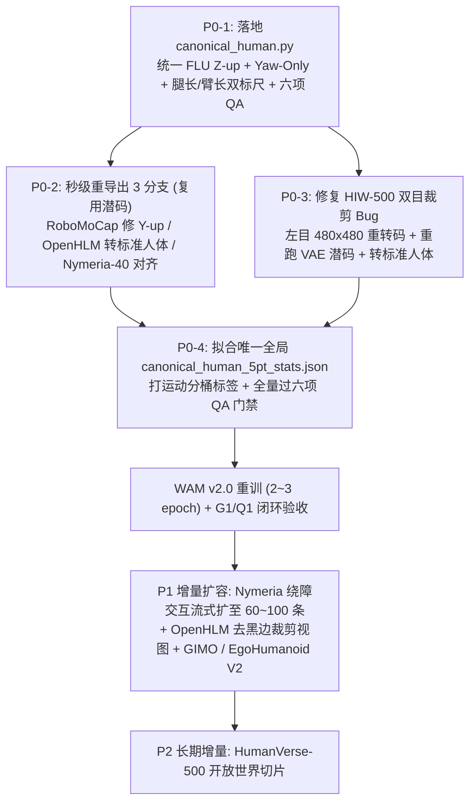

# P1 阶段数据纠偏与扩展执行指南（v2.0 标准人体五点版）

> **更新说明（2026-11-23）**：基于 [评估问题诊断与根因分析](../design/evaluation-diagnosis.md)，当前最紧迫的工作**不是盲目继续下载新数据集**，而是**先修复存量 4 个真实分支的严重数据/坐标缺陷**（`hiw500` 双目跨缝裁剪 Bug、`human-protocol` Y-up 轴向冲突、G1 FK 未重定向到标准人体五点、各分支独立统计量碰撞与定脚静止偏置），随后再按统一 v2.0 规范增量扩容。  
> 详细数学定义与逐数据集处理步骤以 [统一数据处理方案](../design/data-processing.md) 为唯一权威依据。

---

## 1. 执行优先级总览（先纠偏存量，再流式扩容）

---

## 2. P0 存量数据现状与必须执行的修复清单

| 分支 / 数据源 | 存量状态 | 已确认核心问题 | P0 必须动作 | 视频/文本潜码处置 |
| :--- | :--- | :--- | :--- | :--- |
| **HIW-500 G1 (`hiw500`)** | 1,280 回合 / ~556k 窗 | **严重 Bug：`480×1280` 双目被居中跨缝裁剪**；未转标准人体五点；原地低速窗口过多 | 改为左目裁切 `crop=480:480:80:0`；G1 FK → 标准人体五点；写入运动桶标签并限制静止占比 | **重跑 MP4 与视频 VAE 潜码**（文本潜码复用） |
| **RoboMoCap (`human-protocol` + `human-operations`)** | 175+12 会话 / 198k 窗 | 停留在 **Y-up / Z-forward**；双腕未按臂长标准化；`human-new` 大量定脚原地任务 | 旋转对齐至 **Z-up FLU**；改为 Yaw-Only + 腿长/臂长双标尺；打运动桶标签；`human-operations` 保持只读留出 | **全部复用** |
| **OpenHLM G1 (`gripper`)** | 406 回合 / 132k 窗 | 存的是 G1 本体 FK（踝高 `-1.095`、G1 臂长）；180° 圆形鱼眼与针孔域差大 | 从已有 50 Hz `poses.npy` 重定向到标准人体五点（静立踝高 `-1.00`）；P1 增补去黑边中心内切视口 | **原版复用**（P1 增补中心裁切潜码） |
| **Nymeria (`nymeria-40` + 旧 `nymeria`)** | 32 + 3 录制 / ~315k 窗 | 旧 3 条多为沙发坐姿（`L_ank z = -0.454`）；此前因与 Y-up 混训导致 val loss `1.807` | 隔离/降权旧 3 条坐姿；`nymeria-40` 重导出 Yaw-Only + 腿长/臂长双标尺标准人体五点 | **全部复用** |
| **Genie Sim (`sim`)** | 已退出训练 | 合成动作自然度不足 | 继续保持权重 `0.0`，仅用作 G1 / Q1 闭环评测环境 | — |

> **其他存量隔离原则不变**：`egowalk_raw`（缺全身五点）、纯动捕无 RGB（`MotionDecode` 等）、固定底座机械臂数据（`ds_*`、`so101_data`）均**严禁进入 WAM 五点训练集**。

---

## 3. P1 / P2 真人 Ego 增量扩容规则（严格按 v2.0 接入）

所有新增真人数据集统一按 [统一数据处理方案](../design/data-processing.md) 一步到位接入（`embodiment_id = 2`，Z-up FLU Yaw-Only 标准人体五点，共享全局统计量，严禁再各自造一套坐标系或独立五点归一化）：

1. **P1 · Nymeria 定向流式扩容**：
   - 先用官方轻量语言标注索引筛选高含金量“绕障行走 + 桌台/开关/门交互”序列，目标由 32 条扩至 `60~100` 条独立受试者录制；
   - 严格执行“单条下载 VRS → 解码导出标准人体五点 + 潜码 → 过六项 QA 门禁 → 立即删除原始 VRS”的流式存储流程。
2. **P1 · GIMO（Stanford）**：
   - 获取学术授权后编写 `gimo.py`，从 SMPL-X 提取世界 FLU 五点并按受试者实测 $H_{\text{leg}}^{(s)}, L_{\text{arm}}^{(s)}$ 映射至标准人体五点，重点补足多家具室内导航与目标触碰。
3. **P1 · EgoHumanoid / V2（OpenDriveLab）**：
   - 复用其穿戴采集与对齐工具，面向“室内绕障 → 走近桌台 → 按按钮/抓物”定向实采 50–100 条真人演示，直接按 v2.0 契约并入高价值微调集。
4. **P2 · HumanVerse-500（OpenLambda）**：
   - 跟进公开切片与格式规范，走相同的流式解码、标准人体转换与六项 QA 门禁管线。

---

## 4. 每次数据改动后的必检门禁

1. **坐标轴与静立均值自动断言**：全量中位数须满足 `L_ank_z / R_ank_z ∈ [-1.10, -0.85]`、`L_ank_y > +0.05`、`R_ank_y < -0.05`、`wri_x > 0`。
2. **双目拼缝检测 + 20 条 RGB 联系表目视抽检**：重点核验 `hiw500` 修复后无中缝错位、无镜像、无倒置。
3. **往返误差门禁**：`Canonical Human ↔ Q1 / G1` 往返误差 `< 1 mm`、`< 0.1°`。
4. **划分无泄漏**：完整受试者 / 录制会话隔离，`human-operations` 保持独立只读。
