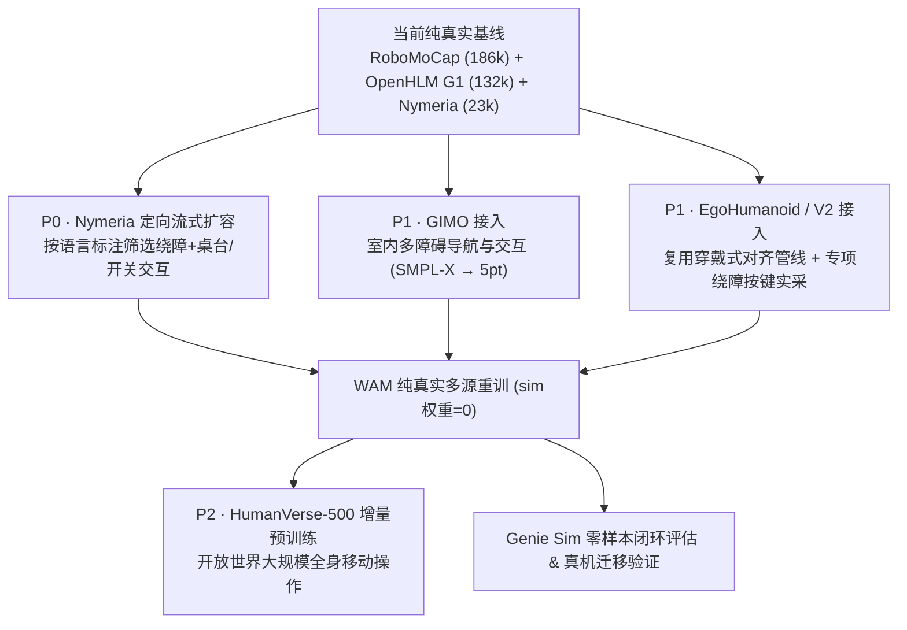

# P1 阶段下一步数据收集与处理执行指南（真人 Ego 优先版）

> **策略更新（2026-11-21 UTC）**：  
> 1. **暂停仿真数据入训**：实测当前 Genie Sim 合成数据（直走按键 537 条及绕障试采 7 条）步态与手部动作仍偏生硬、域特征怪异，**即日起不再将低质量仿真数据加入 WAM 训练集**（`sim` 仅保留作为闭环评估环境与只读归档）。  
> 2. **全面转向真实人类 Ego 全身数据**：在已就绪的 `human-protocol`（RoboMoCap 175 会话 / 186,003 窗口）与 `gripper`（OpenHLM G1 实机 406 回合 / 131,944 窗口）基础上，将 **Nymeria、GIMO、EgoHumanoid、HumanVerse-500** 确立为下一阶段核心真人训练集扩展主线，重点补齐“真实室内绕障行走 → 走到桌台/开关前 → 自然伸手按键/触碰/操作”的连续全身先验。  
> **路径约束**：文档不硬编码宿主机绝对路径，所有根目录均通过环境变量 `${RAW_DATA_ROOT}`、`${PROCESSED_DATA_ROOT}`、`${PRETRAINED_ROOT}`、`${P1_RUN_ROOT}`、`${RUNS_ROOT}` 注入容器。

---

## 1. 当前真实数据盘点与缺口诊断

| 分支 / 数据源 | 当前状态 | 性质 | 已有规模（窗口 / 回合） | 核心优势与当前缺口 | 下一步处置 |
| :--- | :---: | :---: | :--- | :--- | :--- |
| **RoboMoCap (`human-protocol`)** | ✅ 已就绪 | 真实人类 (光学动捕+头相机) | 175 会话 / **186,003** 窗口 | 已有拆分的绕障行走（`task 0/2`）与桌面操作/触碰目标（`task 10/12`）；缺少“同一条轨迹里绕障后顺手按键”的复合任务 | 保留为主干；固定 `human-operations` 留出集 |
| **OpenHLM (`gripper`)** | ✅ 已就绪 | 真实机器人 (G1 遥操) | 406 回合 / **131,944** 窗口 | 已对齐 `4×79` + 完整 `t0` 3D 骨盆系，提供真机移动操作与夹爪先验 | 保留为机器人真机分支 |
| **Nymeria (`nymeria` + `nymeria-40`)** | 🔄 32 条收尾中 | 真实人类 (Aria+Xsens) | 3 + 32 录制 / **~289,530** 窗口 | 32 名新受试者按 `26/3/3` 隔离，3 卡 VAE 潜码缓存收尾中 | 校验后清理 32 条原始 VRS 释放 ~430 GB |
| **HIW-500 (`BitRobot/HIW-500-LeRobot`)** | 🔄 100 GB 精选下载中 | 真实机器人 (G1 开放世界) | ~100 GB 精选子集（覆盖 11 类任务，仅 `head` 相机 + `data`） | 含 G1 29-DoF 关节角 + `observation.state.wbc`（骨盆速度/姿态/高度 + 双手末端）+ 30 Hz 头相机 + 自然语言标注 | 编写 G1 FK + 根里程计适配器导出 `4×79` + `10×47` 并入训练 |
| **EgoHumanoid (`OpenDriveLab`)** | 📦 示例包已下载 | 真实人类 + G1 (PICO VR+ZED) | 154 MB 开源示例（1 人 + 1 G1）+ 完整采集/对齐代码 | 可直接用于验证适配器与后续定向实采 | 保留代码与示例，按需用于专项实采 |
| **GIMO** | 📋 待申请 | 真实人类 (Ego+SMPL-X+3D场景) | 0（待学术授权） | 多家具障碍室内导航与目标交互 | 申请学术授权后接入 `gimo.py` |
| **HumanVerse-500** | 📋 跟进开源切片 | 真实人类 (穿戴 Ego+全身/手) | 0（全量未开放下载） | 500h / 827 开放世界任务 | 跟进 `OpenLambda` 公开切片 |
| **Genie Sim (`sim`)** | 🗑️ 已退出训练 | 仿真合成 | 无用训练缓存已清理 | 当前动作自然度不足 | 仅保留闭环评测环境，不进入训练集 |

> **其他存量数据隔离原则**：`${RAW_DATA_ROOT}/egowalk_raw`（仅有相机里程计，缺全身五点骨架）、纯动捕无 RGB 目录（`MotionDecode` 等）、机械臂/固定底座目录（`ds_*`、`so101_data`）均**严禁进入 WAM 45D 五点训练集**。

---

## 2. 新路线图：四大真人 Ego 全身数据集接入规划

---

## 3. 各真人 Ego 数据源详细接入方案与契约规范

所有新增真人数据集均须严格遵守本仓库统一数据契约：
- **统一输出**：`embodiment_tag = "human_5pt_only"`（`embodiment_id = 2`），`proprio [4, 75]`（过去 4 帧因果历史五点位姿+线速+角速），`actions [10, 45]`（未来 10 步 10 Hz 五点位置+`rot6d`，`ee_action_mask = 0`）。
- **统一坐标系与腿长缩放**：锚定在 `t0` **完整 3D 骨盆坐标系**；下肢（骨盆、左右踝）按受试者实测腿长归一化，双腕保持米制。
- **独立统计与防泄漏**：每个数据源保留独立 `label_provenance`、独立 `stats.json`（仅在各自 `train` split 上拟合），严格按受试者或完整录制会话隔离 `train / val / test`。
- **硬验证门禁**：`human_features -> block_targets` 往返误差 **`< 1 mm`**、旋转误差 **`< 0.1°`**，因果 RGB/姿态时间戳无未来帧泄漏，且抽检 20 条样本通过目视/可视化审查。

### 3.1 P0：Nymeria（Meta ECCV 2024）定向筛选与流式扩容
- **为什么最优先**：仓库已具备完整的 [nymeria.py](../../wammimic/data_pipeline/nymeria.py) 解码、时间对齐与验证管线；300 小时真实室内活动覆盖大量自然绕开桌椅/障碍物并走向台面、开关、门、柜子交互的连续动作。
- **定向筛选策略**：先拉取全量 1,200 条序列的轻量级元数据与分层语言标注索引（不下载 VRS），按关键词筛选高价值室内移动操作序列（如 `walk around`, `avoid`, `counter`, `table`, `switch`, `button`, `press`, `push`, `turn on/off`, `reach`, `pick up`），优先覆盖多受试者与多室内场景。
- **流式存储优化（必须改造）**：单小时原始 Aria VRS 约 51 GB，严禁整批囤积原始 VRS。执行流程改为：
  1. 单条下载 VRS + `xdata.npz` + 标注文件；
  2. 解码导出 224×224 10 Hz RGB、提取 50 Hz 五点真值并缓存 Cosmos-Predict2.5 视频/文本潜码；
  3. 校验往返误差、因果延迟与哈希并写入收据；
  4. **立即删除该条原始 VRS**（保留压缩后的处理产物与潜码，磁盘占用压低 >10×）。
- **目标规模**：先期扩充至 **30–60 条高相关室内移动操作录制**（约 15–30 万有效 10 Hz 窗口），按受试者严格划分 `train / val / test`。

### 3.2 P1：GIMO（Stanford ECCV 2022）接入方案
- **数据特点**：头戴第一视角 RGB + 眼动轨迹 + 真实 3D 室内场景扫描（客厅/卧室/办公室/厨房等满布家具障碍）+ SMPL-X 3D 全身动作序列，聚焦“人在障碍室内走向目标物体并交互”。
- **获取步骤**：按官方仓库 `y-zheng18/GIMO` 流程确认非商用研究协议并向作者申请解密下载链接（可先用官方小规模 Demo 包完成适配器单测）。
- **适配器开发要点（新增 `wammimic/data_pipeline/gimo.py`）**：
  1. 从 SMPL-X 参数（`.pkl` / `.bvh`）经前向运动学提取世界系五点：`pelvis`、`left_ankle`、`right_ankle`、`left_wrist`、`right_wrist`（位置 + 3×3 旋转矩阵），统一重采样至 50 Hz；
  2. 同步头相机 RGB 帧至 10 Hz、中心裁剪/缩放至 224×224，核验与全身姿态的时间戳对齐；
  3. 计算每名受试者静态站立腿长 `human_leg_length`，经统一 `human_features()` / `human_history()` 导出 LeRobot v2 Parquet；
  4. 标记 `label_provenance = "smplx_indoor_ego_reference"`，按场景/受试者划分 `train / val / test`，跑通 `cache-text`、`cache-video` 与坐标往返验证。

### 3.3 P1：EgoHumanoid / EgoHumanoid-V2（OpenDriveLab）接入与专项实采
- **数据特点**：专为“无机器人真人第一视角演示 → 人形机器人全身移动操作”构建，开源了硬件同步（头戴 ZED 相机 + PICO VR / 穿戴全身追踪）与原生 LeRobot 格式对齐工具链（`OpenDriveLab/EgoHumanoid`、`OpenDriveLab/EgoHumanoid-V2`）。
- **两条落地路径**：
  1. **对接公开演示与对齐脚本**：跟进官方 Hugging Face / GitHub 释放的 LeRobot 格式数据子集，直接映射至本仓库 `human_5pt_only` 五点契约（`label_provenance = "vr_ego_humanoid_reference"`）；
  2. **定向专项实采（解决“地面绕障 → 按按钮”最精准路径）**：复用其轻量化穿戴采集工具（`eh2-collect-human` 或自有头戴相机 + 5 点追踪），在真实房间内设置常见地面障碍物与桌面按钮，实采 **50–100 条**（每条 5–8 秒）高自然度真人演示，作为定向微调集直接接入 WAM。

### 3.4 P2：HumanVerse-500（$\lambda_0$ / OpenLambda）接入规划
- **数据特点**：500 小时 / 32,000+ 回合 / 827 开放世界任务，穿戴式第一视角 RGB 同步全身 + 手部 3D 运动，是目前体量最大的人形全身移动操作预训练数据体系。
- **落地步骤**：
  1. 接入 `LambdaHumanoid/openlambda` 开源格式规范与 Hugging Face `lambda-humanoid` 公开样本/切片；
  2. 编写 `wammimic/data_pipeline/humanverse.py` 适配器，将全身+手部 3D 关键点统一映射到本仓库五点骨架、`t0` 完整 3D 骨盆系与受试者腿长归一化（`label_provenance = "wearable_openworld_human_reference"`）；
  3. 若后续获取完整或分批授权数据集，采用与 Nymeria 相同的流式解码-潜码缓存-清理机制并入大规模预训练。

---

## 4. 可视化审查与质量门禁

- **数据可视化审查**：所有新接入的真人 Ego 分支在进入训练前，均须通过可视化页面或 Rerun 抽检（至少 20 条随机片段），确认第一视角画面清晰、左右手与双踝 3D 骨架投影无镜像/翻转、语言标注与实际动作一致。
- **纯真实训练闭环验证**：
  - 训练阶段禁用 `sim` 分支（`--branch-weights` 中 `sim` 置为 `0.0`），避免低质合成轨迹污染人类自然运动先验；
  - 评估阶段保留 Genie Sim 作为**零样本闭环仿真测试台**，用于客观检验真人 Ego 数据训练出的 WAM 在 Q1 + Mimic 上的稳定性与泛化表现。
